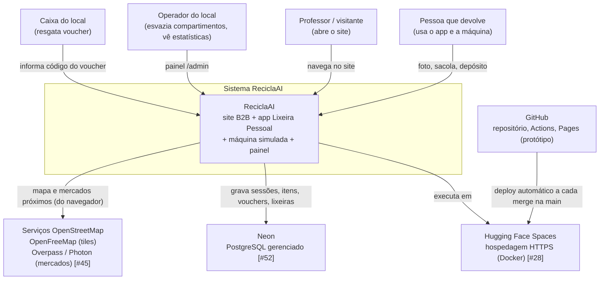
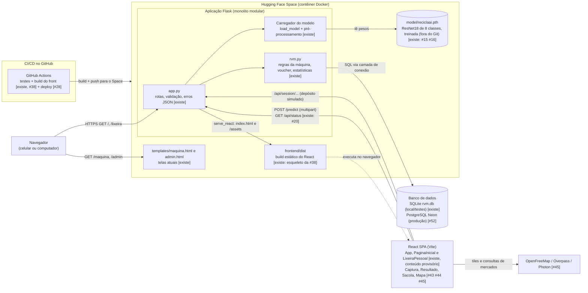
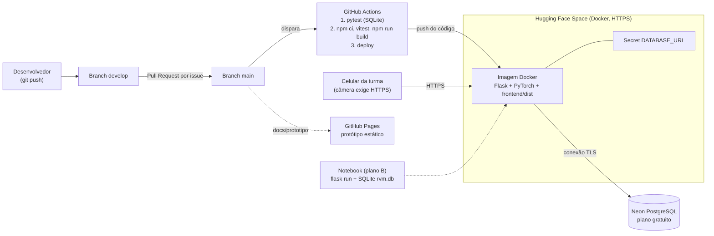

# Arquitetura do ReciclaAI

Documento da issue #12. Descreve a arquitetura **alvo** definida em `docs/visao-do-produto.md` (seções 5, 7, 8 e 8.1) e `docs/plano-de-construcao.md` (Partes 2, 7 e 12). Cada elemento indica se **já existe** no código ou **está planejado** (com a issue que o constrói).

Legenda: **[existe]** já está no repositório · **[#N]** será construído pela issue N.

## 1. Contexto (nível 1)

## 2. Contêineres (nível 2)

### Elementos e estado

| Elemento | Estado | Observação |
|---|---|---|
| `app.py` (rotas `/` e `/lixeira` via `serve_react()`, `/assets/<nome>`, `/maquina`, `/admin`, `/predict`, `/api/session*`, `/api/admin*`, `/api/vouchers/<code>/redeem`) | existe | Serve o build do React (`frontend/dist`) em `/` e `/lixeira` (503 com aviso se não compilado); a simulação da máquina está em `/maquina` (`templates/maquina.html`) (#38 concluída) |
| `rvm.py` (decide, sessões, voucher, lixeiras, estatísticas) | existe | Hoje só SQLite; camada única de conexão em #52 |
| Modelo ResNet18 (`treino.py`, `scripts/preparar_dataset.py`, `model/reciclaai.pth`) | existe (8 classes, incluindo `organic` e `nao_residuo`); treinado em 08/11/2026, com 93,51% de acurácia no teste ([resultados](../modelo/resultados.md)); o `.pth` fica fora do Git | Issues #15 e #16 fechadas |
| `POST /predict` com `machine`, `low_confidence`, `nao_reconhecido`; `GET /api/status`; erros 400, 413, 503 | existe (#20, commit `b24ece7`; a issue segue aberta até o pull request) | A falta do modelo devolve 503 com mensagem em JSON; uploads acima de 5 MB devolvem 413 |
| React SPA (Vite): `App`, `PaginaInicial`, `LixeiraPessoal` | existe (esqueleto, #38) | Conteúdo provisório; compilado para `frontend/dist/` e servido pelo Flask |
| Componentes `Captura`, `Resultado`, `Sacola`, `Mapa` e seções do site | planejado (#43, #44, #45 e demais) | |
| Mapa (Leaflet, OpenFreeMap) e busca real de mercados (Overpass/Photon), com lista salva de Brasília como reserva | planejado (#45) | Chamado pelo navegador; se a busca falhar, usa a lista local |
| PostgreSQL no Neon | planejado (#52) | `DATABASE_URL` escolhe o backend |
| Deploy Hugging Face + Actions | planejado (#28) | Secret `DATABASE_URL` no Space |

## 3. Implantação

Observações:
- Testes e desenvolvimento local usam SQLite (`rvm.db`); sem `DATABASE_URL` o servidor cai nele (#52).
- O arquivo do modelo não vai para o Git; o plano de deploy (#28) deve definir como ele chega ao Space (por exemplo, arquivo grande no repositório do Space ou download no build). **Ponto em aberto.**
- O GitHub Pages hospeda somente o protótipo estático de `docs/prototipo`; não tem backend.

## 4. Estilo arquitetural e justificativa

| Escolha | Justificativa |
|---|---|
| **Monolito modular** (um processo Flask, módulos `app.py`, `rvm.py`, carregador do modelo) | Um endereço e um deploy; menos peças para falhar na defesa. A IA fica em Python, onde foi treinada. Os módulos têm fronteiras claras (rotas, regras, modelo) e podem ser separados depois |
| **Cliente-servidor** | O navegador cuida de apresentação, câmera, sacola e mapa; o servidor cuida de IA, regras e dados |
| **REST/JSON** | Contrato simples e testável (`/predict`, `/api/session/...`); erros sempre em JSON `{error: ...}` |
| **SPA React servida pelo Flask** | Habilita React Bits e GSAP; o Vite gera arquivos estáticos simples. Evita CORS e dois deploys (ver ADR-001) |
| **Banco por `DATABASE_URL`** | SQLite sem instalação nos testes; PostgreSQL com persistência na nuvem (ver ADR-002) |

## 5. Atributos de qualidade

| Atributo | Como a arquitetura atende |
|---|---|
| Usabilidade | Resposta do `/predict` com motivo e dica; erros em linguagem clara; SPA com animação de análise e botão cancelar; HTTPS para a câmera funcionar no celular |
| Manutenibilidade | Regras de negócio isoladas em `rvm.py` (constantes `ACCEPTED`, `REJECT_REASONS`, `MIN_CONFIDENCE`); rotas finas em `app.py`; componentes React pequenos por responsabilidade |
| Testabilidade | `decide()` é função pura; o modelo é substituível por função falsa nos testes (`tests/test_api.py`, #20); SQLite em testes; Vitest no front; CI roda tudo a cada PR |
| Portabilidade | Docker no Hugging Face, `flask run` no notebook; `DATABASE_URL` troca o banco sem mudar as funções de `rvm.py` |
| Privacidade | A foto é lida na requisição, classificada e descartada: nunca é gravada em disco nem no banco. As miniaturas da sacola ficam só na memória do navegador. O banco guarda apenas material, confiança, valor e horários, sem dados pessoais |
| Desempenho | ResNet18 leve, carregada uma vez na inicialização; inferência em CPU atende a demonstração |
| Confiabilidade | Abaixo de 70% de confiança o item é recusado; `nao_residuo` evita falso positivo em selfies; mapa cai na lista salva se a busca falhar |

## 6. Decisões arquiteturais (ADR)

- [ADR-001: React servido pelo Flask](../adr/ADR-001-react-servido-pelo-flask.md) (issue #38)
- ADR-002: PostgreSQL no Neon com SQLite local, `docs/adr/ADR-002-postgresql-neon.md` (a ser escrito na issue #52)

Ver também: [modelo de dados](modelo-de-dados.md) · [diagramas UML](uml.md) · [índice](README.md).
