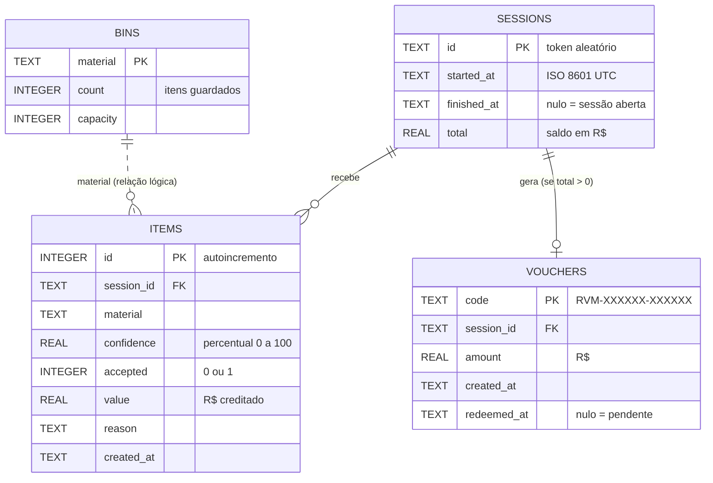

# Modelo de dados

Extraído de `rvm.py` (`init_db`). São quatro tabelas, todas já existentes no SQLite (`rvm.db`). A migração para PostgreSQL (Neon) é a issue #52; as diferenças a tratar estão na seção 5.

## 1. Modelo conceitual

Uma **sessão** é uma visita de uma pessoa à máquina. Em cada sessão a pessoa insere vários **itens** (aceitos ou recusados). Ao finalizar, uma sessão com saldo positivo gera no máximo um **voucher**. As **lixeiras** (compartimentos) são independentes das sessões: guardam a contagem por material e são ligadas aos itens apenas pelo nome do material (relação lógica, sem chave estrangeira).

Não há tabela de usuários: a pessoa não tem conta nem dado pessoal.

## 2. Diagrama entidade-relacionamento

Cardinalidades: uma sessão tem zero ou mais itens; uma sessão tem zero ou um voucher (o código só cria um voucher por `finish_session`, e a sessão só pode ser finalizada uma vez, mas **o esquema não impõe unicidade** em `vouchers.session_id`); cada item pertence a exatamente uma sessão.

## 3. Modelo físico (SQLite atual)

| Tabela | Coluna | Tipo | Restrições |
|---|---|---|---|
| `sessions` | `id` | TEXT | PK |
| | `started_at` | TEXT | NOT NULL |
| | `finished_at` | TEXT | nulável |
| | `total` | REAL | NOT NULL, DEFAULT 0 |
| `items` | `id` | INTEGER | PK, AUTOINCREMENT |
| | `session_id` | TEXT | NOT NULL, FK para `sessions(id)` |
| | `material` | TEXT | NOT NULL |
| | `confidence` | REAL | NOT NULL |
| | `accepted` | INTEGER | NOT NULL (0 ou 1, sem CHECK) |
| | `value` | REAL | NOT NULL |
| | `reason` | TEXT | NOT NULL |
| | `created_at` | TEXT | NOT NULL |
| `vouchers` | `code` | TEXT | PK |
| | `session_id` | TEXT | NOT NULL, FK para `sessions(id)` |
| | `amount` | REAL | NOT NULL |
| | `created_at` | TEXT | NOT NULL |
| | `redeemed_at` | TEXT | nulável |
| `bins` | `material` | TEXT | PK |
| | `count` | INTEGER | NOT NULL, DEFAULT 0 |
| | `capacity` | INTEGER | NOT NULL |

Observações do código:
- `PRAGMA foreign_keys = ON` é ativado a cada conexão (`db()`).
- `init_db` insere uma linha em `bins` por material de `rvm.ACCEPTED` (`plastic`, `metal`, `glass`) e atualiza a capacidade se já existir (`ON CONFLICT ... DO UPDATE`).
- Datas são texto ISO 8601 em UTC (`datetime.now(timezone.utc).isoformat(timespec="seconds")`).
- Itens recusados também são gravados (`accepted = 0`, `value = 0`), o que alimenta as estatísticas de recusa.
- Não há índices além das chaves primárias. Consultas por `items.session_id` e `vouchers.session_id` podem ganhar índice se o volume crescer.

## 4. Dicionário de dados

| Campo | Significado | Valores / formato | Quem escreve |
|---|---|---|---|
| `sessions.id` | Identificador da sessão | `secrets.token_urlsafe(12)` | `start_session` |
| `sessions.started_at` | Início da sessão | ISO 8601 UTC | `start_session` |
| `sessions.finished_at` | Fim da sessão; nulo enquanto aberta | ISO 8601 UTC | `finish_session` |
| `sessions.total` | Saldo acumulado dos itens aceitos | R$, soma dos `value` aceitos | `insert_item` |
| `items.id` | Identificador do item | inteiro crescente | banco |
| `items.session_id` | Sessão do item | FK | `insert_item` |
| `items.material` | Classe prevista pelo modelo | `plastic`, `metal`, `glass`, `paper`, `cardboard`, `trash` (e, após #15/#16/#20, `organic`, `nao_residuo`) | `insert_item` |
| `items.confidence` | Confiança do modelo | 0 a 100 (%) | `insert_item` |
| `items.accepted` | A máquina aceitou o item | 1 aceito, 0 recusado | `insert_item` |
| `items.value` | Crédito do item | R$ 0,10, 0,15, 0,25 ou 0 | `insert_item` |
| `items.reason` | Mensagem mostrada à pessoa | texto de `Decision.reason` | `insert_item` |
| `items.created_at` | Momento da inserção | ISO 8601 UTC | `insert_item` |
| `vouchers.code` | Código impresso no voucher | `RVM-` + 6 hex + `-` + 6 hex | `finish_session` |
| `vouchers.session_id` | Sessão de origem | FK | `finish_session` |
| `vouchers.amount` | Valor do voucher | R$ (> 0) | `finish_session` |
| `vouchers.created_at` | Emissão | ISO 8601 UTC | `finish_session` |
| `vouchers.redeemed_at` | Resgate no caixa; nulo = pendente | ISO 8601 UTC | `redeem_voucher` |
| `bins.material` | Material do compartimento | `plastic`, `metal`, `glass` | `init_db` |
| `bins.count` | Itens atualmente guardados | inteiro >= 0 | `insert_item`, `empty_bin` |
| `bins.capacity` | Capacidade em itens | 200, 300, 100 | `init_db` |

Regra derivada: lixeira cheia quando `count >= capacity`; aviso ao operador a partir de 85% (`FULL_WARNING_PCT`).

## 5. SQLite x PostgreSQL (a tratar na issue #52)

| Tema | SQLite (hoje) | PostgreSQL (Neon) | Ação |
|---|---|---|---|
| Chave automática | `INTEGER PRIMARY KEY AUTOINCREMENT` | `GENERATED ALWAYS AS IDENTITY` (preferido) ou `SERIAL` | DDL separado por backend |
| Placeholders | `?` | `%s` (psycopg) | Camada de conexão converte ou usa um único estilo |
| Linhas como dicionário | `sqlite3.Row` | cursor com `dict_row` | Camada de conexão devolve o mesmo formato |
| Dinheiro | `REAL` | `NUMERIC(10,2)` | Ver abaixo |
| Booleano | `INTEGER` 0/1 | `BOOLEAN` ou `SMALLINT` | Manter `SMALLINT` evita mudar `SUM(accepted)` |
| Datas | `TEXT` ISO | `TIMESTAMPTZ` (ideal) | Pode manter `TEXT` na primeira versão; migrar depois |
| Chaves estrangeiras | exige `PRAGMA foreign_keys = ON` | sempre ativas | Remover o PRAGMA no ramo PostgreSQL |
| Criar esquema | `executescript` | uma instrução por `execute` | Dividir o script |
| Upsert | `ON CONFLICT(material) DO UPDATE SET capacity = excluded.capacity` | mesma sintaxe | Compatível |
| `COUNT(*) - SUM(accepted)` | inteiro | `SUM` de inteiro devolve `bigint`; `SUM` de `NUMERIC` devolve `NUMERIC` (`Decimal` no Python) | Converter com `float()`/`round` antes do `jsonify` |
| Transações | commit no fim do `with` | idem; conexão por requisição ou pool | Manter o padrão do `db()` |

### Dinheiro: por que não usar ponto flutuante

`REAL` e `FLOAT` guardam binário aproximado: 0,10 + 0,15 + 0,25 pode resultar em 0,5000000000000001, e somas longas acumulam erro. O código atual mascara isso com `round(..., 2)` na saída, mas comparações (`amount > 0`), somas no banco (`SUM(value)`) e conciliação com o caixa ficam frágeis. Recomendação:

1. **`NUMERIC(10,2)`** nas colunas `sessions.total`, `items.value` e `vouchers.amount` do PostgreSQL: aritmética decimal exata e dois dígitos garantidos pelo banco.
2. Alternativa mais simples de portar entre os dois bancos: **inteiro em centavos** (`value_cents`), que funciona igual no SQLite e no PostgreSQL; a conversão para R$ acontece só na apresentação.

A escolha final cabe ao ADR-002. Em qualquer caso, `Decision.value` e `ACCEPTED[...]["value"]` em `float` devem virar `Decimal` ou centavos para não reintroduzir o erro na camada de regras.

## 6. Retenção e privacidade

- **Nenhuma imagem é armazenada.** A foto enviada ao `/predict` ou ao `/api/session/<id>/insert` é lida em memória, classificada e descartada. Só ficam no banco o material previsto, a confiança, o valor, o motivo e horários.
- Não há nome, e-mail, telefone, CPF nem identificador de dispositivo. O `session_id` e o `code` são tokens aleatórios sem ligação com uma pessoa.
- As miniaturas da sacola do app existem apenas na memória do navegador até o depósito.
- Retenção sugerida para a demonstração: manter as tabelas enquanto o Neon gratuito comportar; não há rotina de expurgo hoje. Se o projeto evoluir, definir prazo para apagar `items` e sessões antigas (por exemplo, 12 meses) mantendo agregados em `stats`.
- O voucher é um segredo de curta duração: `redeem_voucher` impede o uso duplo gravando `redeemed_at`.

Ver também: [arquitetura](arquitetura.md) · [UML](uml.md) · [índice](README.md).
