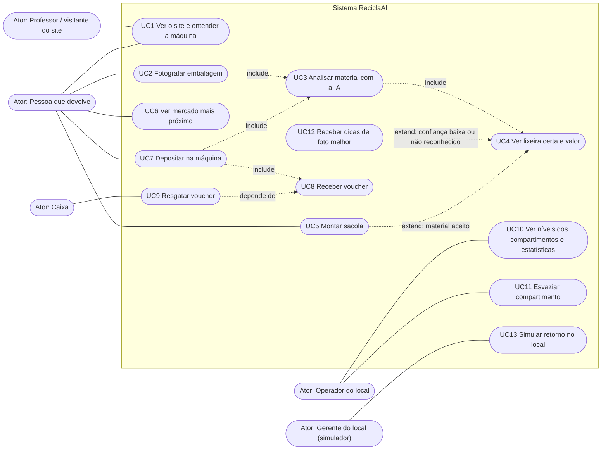
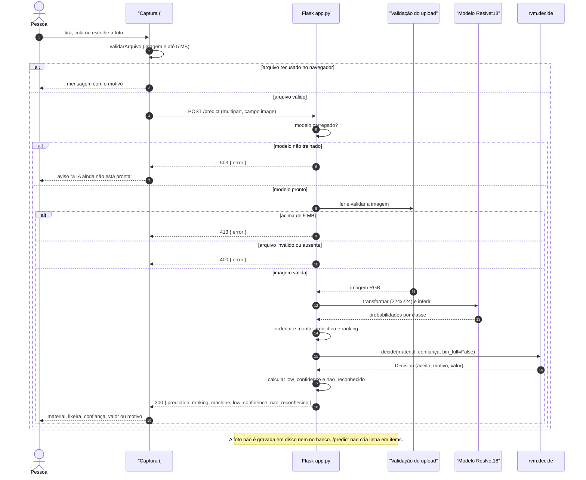
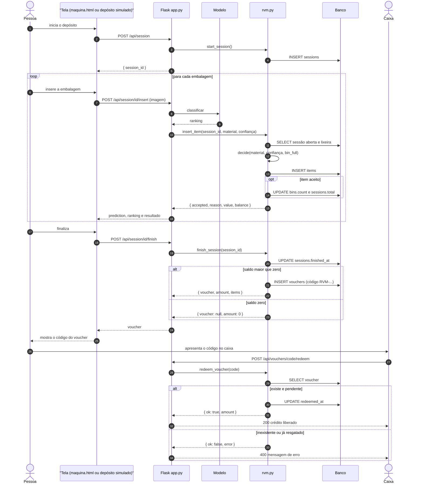
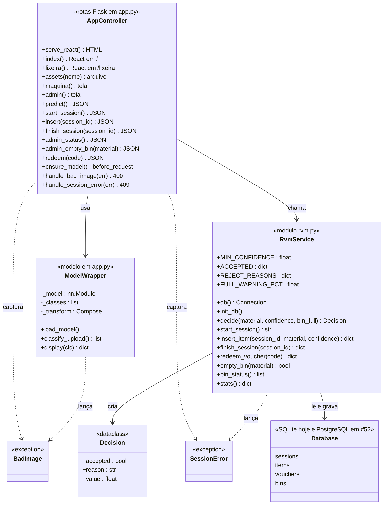
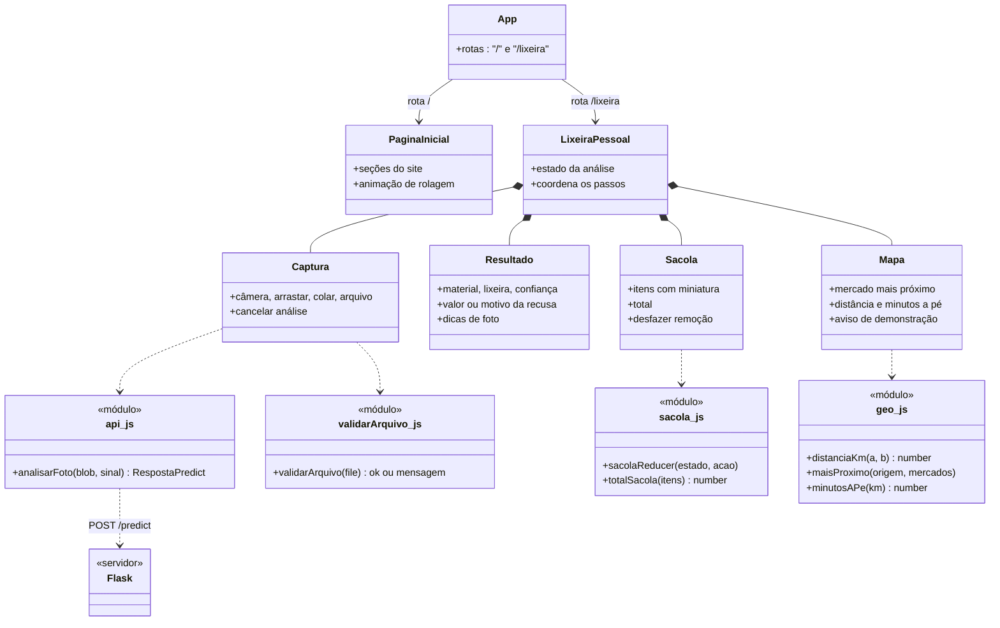
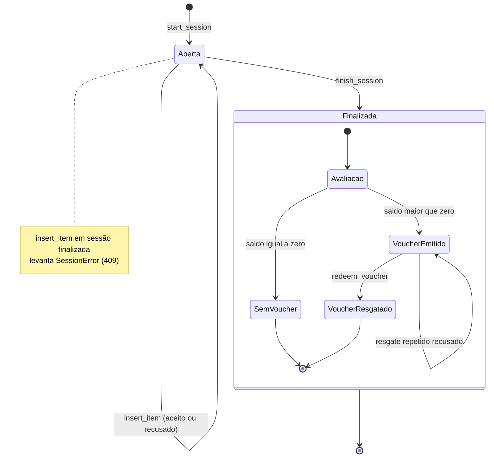

# Diagramas UML

Todos em Mermaid (renderizam no GitHub). Elementos marcados como **[existe]** estão no código atual; **[#N]** são planejados na issue N.

## 1. Casos de uso

O Mermaid não tem sintaxe nativa de casos de uso; o diagrama usa `flowchart`: atores como nós retangulares, casos de uso como nós em formato de pílula dentro da fronteira do sistema, e `include`/`extend` como setas pontilhadas rotuladas.

Rastreio com o código e as issues: UC2 a UC6 e UC12 = subpágina Lixeira Pessoal (seção 7 da visão do produto; componentes `Captura`, `Resultado`, `Sacola` e `Mapa`, issues #43 a #45); UC7 e UC8 = depósito simulado e máquina (rotas `/api/session` **[existe]**); UC9 = `POST /api/vouchers/<code>/redeem` **[existe]**; UC10 e UC11 = painel `/admin` **[existe]**; UC1 = site em React (esqueleto **[existe]**, seções nas issues seguintes); UC13 = simulador de impacto no local (issue #48, HU-11).

### 1.1 Casos de uso x histórias de usuário

Histórias em [../requisitos/historias-de-usuario.md](../requisitos/historias-de-usuario.md).

| Caso de uso | Histórias de usuário |
|---|---|
| UC1 Ver o site e entender a máquina | HU-13 (e HU-16 como acesso ao site publicado) |
| UC2 Fotografar embalagem | HU-01, HU-03 |
| UC3 Analisar material com a IA | HU-01, HU-02, HU-03 |
| UC4 Ver lixeira certa e valor | HU-01 |
| UC5 Montar sacola | HU-04 |
| UC6 Ver mercado mais próximo | HU-05, HU-12 |
| UC7 Depositar na máquina | HU-06, HU-07 |
| UC8 Receber voucher | HU-06, HU-07 |
| UC9 Resgatar voucher | HU-08 |
| UC10 Ver níveis dos compartimentos e estatísticas | HU-09 |
| UC11 Esvaziar compartimento | HU-10 |
| UC12 Receber dicas de foto melhor | HU-02 |
| UC13 Simular retorno no local | HU-11 |

HU-15 (heurísticas de Nielsen documentadas) e HU-16 (abrir o projeto publicado no celular) são requisitos **não funcionais**: não geram caso de uso próprio. HU-16 é atendida pela implantação (ver [arquitetura.md](arquitetura.md), seção 3) e HU-15 pelo documento da issue #46.

## 2. Sequência: analisar foto no app

Estado atual do código: o lado do servidor está pronto (#20, commit `b24ece7`): `/predict` valida (400), recusa acima de 5 MB (413), devolve 503 sem modelo e responde com `prediction`, `ranking`, `machine`, `low_confidence` e `nao_reconhecido`. O componente `Captura` ainda não existe (#43); o `App` do React já existe (#38).

## 3. Sequência: depósito na máquina e voucher

Erros de sessão: sessão inexistente ou já finalizada levanta `SessionError`, traduzido em `409` pelo `app.py`.

## 4. Diagramas de classes

### 4.1 Backend [existe, com ajustes de #20 e #52]

### 4.2 Frontend (`App`, `PaginaInicial` e `LixeiraPessoal` existem como esqueleto da #38; os demais são #43, #44 e #45)

## 5. Estados de uma sessão e do voucher

Correspondência com o banco: `Aberta` = `finished_at IS NULL`; `VoucherEmitido` = linha em `vouchers` com `redeemed_at IS NULL`; `VoucherResgatado` = `redeemed_at` preenchido.

Ver também: [arquitetura](arquitetura.md) · [modelo de dados](modelo-de-dados.md) · [índice](README.md).
