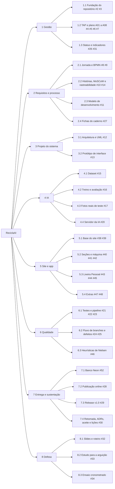

# A03 · Estrutura Analítica do Projeto (EAP)

> Issue #5 · Referência: SOMMERVILLE, Ian. *Engenharia de software*. 10. ed. São Paulo: Pearson,
> 2018. Seção 23.2.1, p. 636 (divisão do trabalho) e 23.3, p. 639. Regra dos 100%: o conjunto dos
> pacotes cobre todo o trabalho do projeto, e cada pacote aponta para uma ou mais issues.
>
> Issues fechadas e substituídas: #18 (site promocional), #19 (subpágina Teste a IA) e #50 (rolagem
> suave e fundo 3D) foram substituídas por #38 a #46; Lenis e Vanta estão em #39 e #40. A busca real
> de mercados (antes #49) foi absorvida por #45.

## Diagrama

## Dicionário da EAP

| Código | Pacote / entrega | Issues | Critério de aceitação | Responsável |
|---|---|---|---|---|
| 1 | Gestão | | Plano publicado em `docs/gestao` | Autor |
| 1.1 | Fundação do repositório e quadro | #2, #3 | Repositório próprio e Kanban com marcos | Autor |
| 1.2 | TAP e plano (A01 a A08) | #4, #5, #6, #7 | Artefatos revisados e aprovados pelo professor no I1 | Autor |
| 1.3 | Status semanal e indicadores finais | #26, #31 | A09 atualizado toda semana; indicadores finais no I3 | Autor |
| 2 | Requisitos e processo | | Rastreáveis até as histórias | Autor |
| 2.1 | Linha do tempo da jornada e BPMN | #8, #9 | BPMN atual e com a RVM | Autor |
| 2.2 | Histórias com MoSCoW e matriz de rastreabilidade | #10, #14 | Critérios de aceitação em cada história | Autor |
| 2.3 | Justificativa do modelo de desenvolvimento | #11 | [modelo-de-desenvolvimento.md](modelo-de-desenvolvimento.md) | Autor |
| 2.4 | Fichas restantes do caderno (2, 7 e 9) | #27 | Fichas preenchidas | Autor |
| 3 | Projeto do sistema | | Diagramas coerentes com o código | Autor |
| 3.1 | Arquitetura, modelo de dados e UML | #12 | Diagramas em `docs/` | Autor |
| 3.2 | Protótipo de interface | #13 (concluída) | Protótipo aprovado em 07/11 | Autor |
| 4 | IA | | Acurácia mínima de 80% em fotos reais | Autor |
| 4.1 | Dataset com orgânico e não é resíduo | #15 | Split sem vazamento entre treino e teste | Autor |
| 4.2 | Treino e avaliação | #16 | Métricas registradas | Autor |
| 4.3 | Fotos reais de teste | #17 | Conjunto de teste fora do treino | Autor |
| 4.4 | Servidor da lixeira pessoal | #20 | Erros 400, 413 e 503 com mensagem clara | Autor |
| 5 | Site e app | | Seguir a visão do produto | Autor |
| 5.1 | Esqueleto React e identidade visual (inclui Lenis e Vanta) | #38, #39 | `npm run build` servido pelo Flask | Autor |
| 5.2 | Seções do problema, ilustração e montagem ao rolar | #40, #41, #42 | Respeita `prefers-reduced-motion` | Autor |
| 5.3 | Lixeira Pessoal: foto, retorno, sacola e mapa (com busca real) | #43, #44, #45 | Fluxo completo no celular | Autor |
| 5.4 | Extras: depósito simulado e seções de impacto | #47, #48 | Só se sobrar tempo | Autor |
| 6 | Qualidade | | Testes verdes no pipeline | Autor |
| 6.1 | Testes, pipeline e ambiente reproduzível | #21, #22, #23 | Concluído em 07/11 | Autor |
| 6.2 | Fluxo de branches e registro de defeitos | #24, #25 | PR por issue; defeitos como issues | Autor |
| 6.3 | Heurísticas de Nielsen | #46 | 10 heurísticas com print e arquivo | Autor |
| 7 | Entrega e sustentação | | Site no ar e release | Autor |
| 7.1 | Banco PostgreSQL (Neon) com SQLite local | #52 | Dados sobrevivem a reinícios | Autor |
| 7.2 | Publicação online | #28 | URL HTTPS acessível a terceiros | Autor |
| 7.3 | Release v1.0 | #29 | Tag v1.0 na `main` com notas | Autor |
| 7.4 | Retomada, ADRs, aceite e lições | #30 | Outra pessoa sobe o sistema pelo README | Autor |
| 8 | Defesa | | Apresentação de 15 a 20 min | Autor |
| 8.1 | Slides e roteiro | #32 | Roteiro cronometrado | Autor |
| 8.2 | Estudo para a arguição | #33 | Cada parte do código explicável | Autor |
| 8.3 | Ensaio cronometrado | #34 | Ensaio dentro do tempo | Autor |
