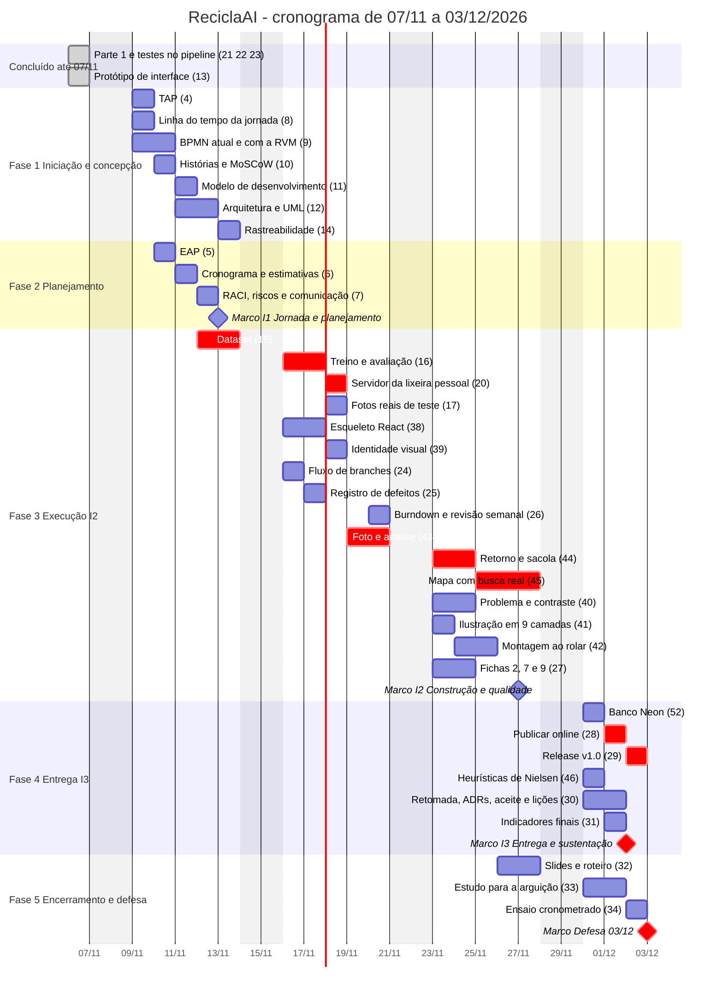

# A04 · Cronograma, marcos e caminho crítico

> Issue #6 · Referência: SOMMERVILLE, Ian. *Engenharia de software*. 10. ed. São Paulo: Pearson,
> 2018. Seção 23.3, p. 638–643 (Fig. 23.4 a 23.6: atividades, marcos e gráfico de barras).
> Marco não é entregável (p. 641). Contingência de 30% a 50% (p. 640): ver [A05](A05-estimativas.md).
>
> Período de 07/11 a 03/12/2026, em dias úteis. Estrutura em fases (iniciação e concepção,
> planejamento, execução com entregas, entrega e encerramento), com **marcos de duração zero** ao
> fim de cada fase e de cada iteração, predecessoras explícitas em todas as tarefas e um único
> recurso: o **Autor do projeto** (o Professor aparece só nas aprovações e na avaliação). Parte 1 e
> protótipo foram concluídos em 07/11.

## Horas e hipóteses

As estimativas vêm do plano de construção e dos textos das issues. As issues #17, #24 a #34 não têm
estimativa registrada; adotaram-se valores assumidos (asterisco). O #45 passou a incluir a busca
real de mercados (1,5 h do plano mais 0,5 h do antigo #49). Total da linha de base: **41,5 h**
para cerca de 40 h disponíveis.

| Janela | Horas |
|---|---|
| I1 · 09 a 13/11 (gestão e requisitos, mais #15) | 10 |
| I2 · 16 a 20/11 | 10 |
| I2 · 23 a 27/11 | 11 |
| I3 e Defesa · 30/11 a 03/12 | 10,5 |
| **Total** | **41,5** |

## Gráfico de barras

As tarefas em vermelho (`crit`) formam o caminho crítico; os losangos são marcos. Os extras (#47,
#48) ficam fora da linha de base. O #45 aparece na fase de execução e o #32 na fase de defesa.

## Caminho crítico

**#15 dataset → #16 treino → #20 servidor → #43 foto e análise → #44 retorno e sacola →
#45 mapa com busca real → #28 publicação → #29 release → Marco I3 → Marco Defesa**

| Tarefa | Estimativa (h) |
|---|---|
| #15 Dataset | 2,5 |
| #16 Treino e avaliação | 2 |
| #20 Servidor | 1 |
| #43 Foto e análise | 1,5 |
| #44 Retorno e sacola | 1,5 |
| #45 Mapa com busca real | 2 |
| #28 Publicação | 1,5* |
| #29 Release | 0,5* |
| **Total** | **12,5** |

O banco (#52) depende do servidor (#20), porque a camada de acesso está no `rvm.py`, e não do
retorno (#44). Por isso ele saiu do caminho crítico: tem folga de 2,5 h. A publicação (#28) só
começa depois do banco, do mapa (#45) e da montagem (#42); o mapa é o último a terminar e passou
a definir o caminho, por incluir a busca real.

## Tabela de atividades

Recurso: **Autor** em todas as tarefas; nos marcos, o Professor aprova ou avalia. Início e término
cedos em horas acumuladas de trabalho, na rede de precedências com recursos ilimitados (zero é o
começo do projeto). Folga é a diferença entre o início tardio e o cedo, sem atrasar a defesa.
Asterisco indica estimativa assumida. Marcos têm duração zero e não são entregáveis. Convenção da folga dos marcos de iteração (MI1, MI2): como não têm sucessora de trabalho, o término tardio é o fim do projeto (12,5 h); assim MI2 tem folga de 2 h, enquanto MI3 e a Defesa, que fecham o caminho crítico, têm zero. As folgas das tarefas (#40, #27 etc.) são medidas até as sucessoras reais, não até esses marcos.

| ID | Atividade | Predecessoras | Recurso | Est. (h) | Início cedo | Término cedo | Folga (h) | Janela planejada |
|---|---|---|---|---|---|---|---|---|
| **F1** | **Fase 1 · Iniciação e concepção** | | Autor | | | | | 09 a 13/11 |
| #4 | TAP e partes interessadas | nenhuma | Autor | 0,5 | 0 | 0,5 | 10,5 | 09/11 |
| #8 | Linha do tempo da jornada | nenhuma | Autor | 0,5 | 0 | 0,5 | 6,5 | 09/11 |
| #9 | BPMN | nenhuma | Autor | 1,5 | 0 | 1,5 | 11 | 09 a 10/11 |
| #10 | Histórias e MoSCoW | #8 | Autor | 1 | 0,5 | 1,5 | 6,5 | 10/11 |
| #11 | Modelo de desenvolvimento | #10 | Autor | 0,5 | 1,5 | 2 | 10,5 | 11/11 |
| #12 | Arquitetura e UML | #10 | Autor | 1,5 | 1,5 | 3 | 6,5 | 11 a 12/11 |
| #14 | Rastreabilidade | #10, #12 | Autor | 0,5 | 3 | 3,5 | 9 | 13/11 |
| **F2** | **Fase 2 · Planejamento** | #4 | Autor | | | | | 10 a 12/11 |
| #5 | EAP | #4 | Autor | 0,5 | 0,5 | 1 | 10,5 | 10/11 |
| #6 | Cronograma e estimativas | #5 | Autor | 0,5 | 1 | 1,5 | 10,5 | 11/11 |
| #7 | RACI, riscos e comunicação | #6 | Autor | 0,5 | 1,5 | 2 | 10,5 | 12/11 |
| **MI1** | **Marco I1 · Jornada e planejamento** | #7, #9, #11, #14 | Autor / Professor (aprova) | 0 | 3,5 | 3,5 | 9 | 13/11 |
| **F3** | **Fase 3 · Execução I2 · Construção e qualidade** | MI1 | Autor | | | | | 12 a 27/11 |
| **#15** | **Dataset** | nenhuma | Autor | 2,5 | 0 | 2,5 | **0** | 12 a 13/11 |
| **#16** | **Treino e avaliação** | #15 | Autor | 2 | 2,5 | 4,5 | **0** | 16 a 17/11 |
| **#20** | **Servidor** | #16 | Autor | 1 | 4,5 | 5,5 | **0** | 18/11 |
| #17 | Fotos reais de teste* | #16 | Autor | 1 | 4,5 | 5,5 | 6,5 | 18/11 |
| #38 | Esqueleto React | nenhuma | Autor | 1,5 | 0 | 1,5 | 3 | 16 a 17/11 |
| #39 | Identidade visual, Lenis e Vanta | #38 | Autor | 1 | 1,5 | 2,5 | 3 | 18/11 |
| #24 | Fluxo de branches* | nenhuma | Autor | 0,5 | 0 | 0,5 | 12 | 16/11 |
| #25 | Registro de defeitos* | nenhuma | Autor | 0,5 | 0 | 0,5 | 12 | 17/11 |
| #26 | Burndown e revisão semanal* | nenhuma | Autor | 1 | 0 | 1 | 11,5 | 20/11 |
| **#43** | **Foto e análise** | #20, #39 | Autor | 1,5 | 5,5 | 7 | **0** | 19 a 20/11 |
| **#44** | **Retorno e sacola** | #43 | Autor | 1,5 | 7 | 8,5 | **0** | 23 a 24/11 |
| **#45** | **Mapa com busca real** | #44 | Autor | 2 | 8,5 | 10,5 | **0** | 25 a 27/11 |
| #40 | Problema e contraste | #39 | Autor | 1,5 | 2,5 | 4 | 8,5 | 23 a 24/11 |
| #41 | Ilustração em 9 camadas | #39 | Autor | 1 | 2,5 | 3,5 | 5,5 | 23/11 |
| #42 | Montagem ao rolar | #41 | Autor | 1,5 | 3,5 | 5 | 5,5 | 24 a 25/11 |
| #27 | Fichas 2, 7 e 9* | #10 | Autor | 1,5 | 1,5 | 3 | 9,5 | 23 a 24/11 |
| **MI2** | **Marco I2 · Construção e qualidade** | #45, #42, #40, #27, #26, #24, #25, #17 | Autor / Professor (aprova) | 0 | 10,5 | 10,5 | 2 | 27/11 |
| **F4** | **Fase 4 · Entrega I3 · Entrega e sustentação** | MI2 | Autor | | | | | 30/11 a 02/12 |
| #52 | Banco Neon | #20 | Autor | 2,5 | 5,5 | 8 | 2,5 | 30/11 |
| **#28** | **Publicação online** | #52, #42, #45 | Autor | 1,5* | 10,5 | 12 | **0** | 01/12 |
| **#29** | **Release v1.0** | #28, #17 | Autor | 0,5* | 12 | 12,5 | **0** | 02/12 |
| #46 | Heurísticas de Nielsen | #42, #44, #45 | Autor | 1 | 10,5 | 11,5 | 1 | 30/11 |
| #30 | Retomada, ADRs, aceite e lições* | #12 | Autor | 1,5 | 3 | 4,5 | 8 | 30/11 a 01/12 |
| #31 | Indicadores finais* | #44 | Autor | 0,5 | 8,5 | 9 | 3,5 | 01/12 |
| **MI3** | **Marco I3 · Entrega e sustentação** | #29, #46, #30, #31 | Autor / Professor (aprova) | 0 | 12,5 | 12,5 | **0** | 02/12 |
| **F5** | **Fase 5 · Encerramento e defesa** | MI2 | Autor | | | | | 26/11 a 03/12 |
| #32 | Slides e roteiro* | #44 | Autor | 2 | 8,5 | 10,5 | 1 | 26 a 27/11 |
| #33 | Estudo para a arguição* | #12 | Autor | 2 | 3 | 5 | 6,5 | 30/11 a 01/12 |
| #34 | Ensaio cronometrado* | #32, #33 | Autor | 1 | 10,5 | 11,5 | 1 | 02/12 |
| **MDEF** | **Marco Defesa 03/12** | MI3, #34 | Autor / Professor (avalia) | 0 | 12,5 | 12,5 | **0** | 03/12 |

Soma das estimativas: **41,5 h** (7,5 em I1; 21,5 em I2; 7,5 em I3; 5 em Defesa).

## O que o caminho crítico significa

- As 12,5 h do caminho crítico formam a sequência mais longa de dependências. Atraso em qualquer
  uma delas atrasa a defesa, porque a folga é zero. O dataset (#15) é o ponto mais sensível:
  sem ele não há IA real na subpágina nem o que publicar.
- Com uma só pessoa, as tarefas fora do caminho disputam as mesmas horas. A regra é fazer o
  caminho crítico primeiro e encaixar as demais nas folgas.
- #52, #28 e #29 ficam dentro da janela da I3 (30/11 a 02/12), sem início em fim de semana. O
  release (#29) termina em 02/12, **um dia útil antes** da defesa. A margem de calendário é
  pequena, por isso a contingência é de escopo (ver [A05](A05-estimativas.md)).
- #46, #32 e #34 têm folga de apenas 1 h: são os primeiros a monitorar depois do caminho crítico.
- O peso do mapa (#45) mostra o efeito da mudança M05 ([A10](A10-mudancas.md)): incluir a busca
  real aumentou o caminho crítico em 0,5 h.
