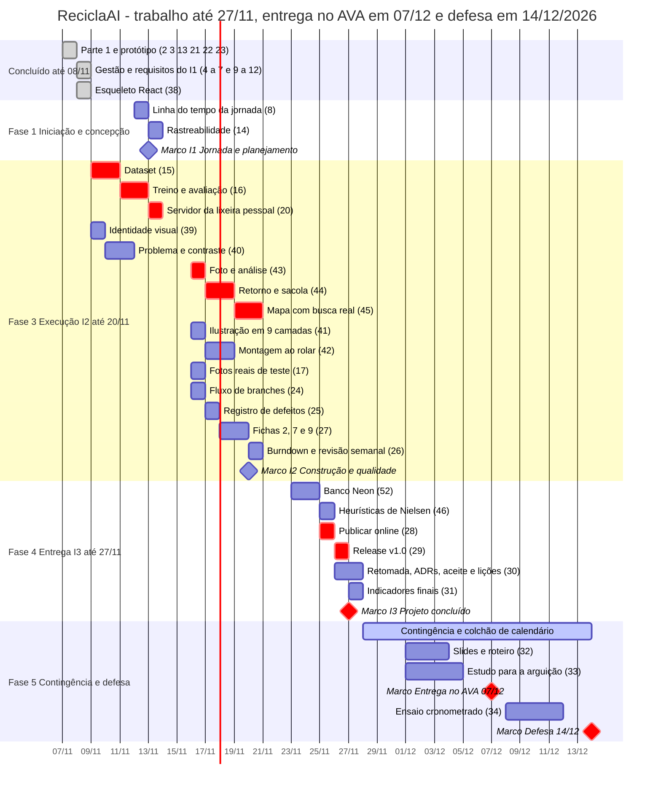

# A04 · Cronograma, marcos e caminho crítico

> Issue #6 · Referência: SOMMERVILLE, Ian. *Engenharia de software*. 10. ed. São Paulo: Pearson,
> 2018. Seção 23.3, p. 638–643 (Fig. 23.4 a 23.6: atividades, marcos e gráfico de barras).
> Marco não é entregável (p. 641). Contingência de 30% a 50% (p. 640): ver [A05](A05-estimativas.md).
>
> Período de 07/11 a 27/11/2026 para todo o trabalho do projeto, mais o preparo da defesa (28/11 a
> 13/12), a entrega no AVA em 07/12 e a defesa em 14/12/2026. Cronograma **antecipado pela mudança
> M07** ([A10](A10-mudancas.md), aprovada em 08/11/2026): o trabalho termina em 27/11. A **mudança
> M08** (aprovada em 12/11/2026) moveu a defesa de 03/12 para 14/12, sem replanejar a linha de base
> de execução até 27/11: 28/11 a 13/12 ficam como contingência e preparo. Estrutura em fases (iniciação e concepção, planejamento, execução com entregas, entrega e
> encerramento), com **marcos de duração zero** ao fim de cada fase e de cada iteração,
> predecessoras explícitas em todas as tarefas e um único recurso: o **Autor do projeto** (o
> Professor aparece só nas aprovações e na avaliação). Parte 1 e protótipo foram concluídos em
> 07/11; a documentação do I1 e o esqueleto React (#38), em 08/11.

## Horas e hipóteses

As estimativas vêm do plano de construção e dos textos das issues. As issues #17, #24 a #34 não têm
estimativa registrada; adotaram-se valores assumidos (asterisco). O #45 passou a incluir a busca
real de mercados (1,5 h do plano mais 0,5 h do antigo #49). Total da linha de base: **41,5 h**
para cerca de 40 h disponíveis. Depois da M07 e da M08 a soma é a mesma, em outra distribuição no
calendário.

| Janela | Horas | Conteúdo |
|---|---|---|
| Concluído em 07 e 08/11 | 8,0 | #4 a #7, #9 a #12 e #38 |
| 09 a 13/11 (fim do I1) | 9,0 | #8, #14, #15, #16, #20, #39, #40 |
| 16 a 20/11 (fim do I2) | 12,0 | #17, #24 a #27, #41 a #45 |
| 23 a 27/11 (I3, fim do trabalho) | 7,5 | #28 a #31, #46, #52 |
| 30/11 a 14/12 (preparo e defesa) | 5,0 | #32, #33, #34 |
| **Total** | **41,5** | |

As 33,5 h que restam depois de 08/11 incluem 5 h de preparo da defesa; as 28,5 h de trabalho até 27/11 somam
cerca de 9,5 h por semana em três semanas, abaixo das 10 h disponíveis. A semana de 16 a 20/11 é a
mais carregada (12 h) e deve ser vigiada ([A07](A07-riscos.md), R1).

## Datas externas

Datas que vêm da disciplina e não do plano. Elas limitam o cronograma, mas não são tarefas do
projeto.

| Data | O que é | Efeito no plano |
|---|---|---|
| 23/11 ou 30/11/2026 | Prova da disciplina (60% a 70% de gerenciamento de projetos) | Se for em 23/11, disputa horas com o I3; se for em 30/11, o dia fica sem tarefa do projeto. Risco R14 em [A07](A07-riscos.md) |
| 07/12/2026, até 23:59 | Entrega dos artefatos no AVA, em arquivo `Nome_Matricula_tema_data` | Limite real para documentos, release e slides. Marco MAVA |
| 14/12/2026 | Defesa (apresentação final e arguição), mudança M08 | Pode ser antes, na data que o professor divulgar. Marco MDEF |

Retorno do professor em 11/11/2026: "projeto bem estruturado… no caminho certo". Nenhuma mudança
foi pedida.

Se o professor marcar a defesa antes de 14/12, o preparo se comprime na janela que a M07 já
previa (30/11 a 02/12), que basta para as 5 h. Se a data cair antes de 03/12, aplica-se a ordem de
cortes de [A05](A05-estimativas.md) e a mudança é registrada em [A10](A10-mudancas.md).

## Gráfico de barras

As tarefas em vermelho (`crit`) formam o caminho crítico; os losangos são marcos. O eixo é de
dias corridos, para que o fim de semana apareça como lacuna.

Os extras #47 e #48 só entram se sobrar tempo, dentro da janela de 23 a 27/11, e ficam fora da
linha de base. Os fins de semana (28 e 29/11, 05 e 06/12, 12 e 13/12) ficam livres. O dia 30/11
fica sem tarefa porque a prova pode cair nele. O #34 são dois ensaios de 30 minutos, um em 08/12 e
outro em 11/12; a barra cobre o intervalo entre eles.

## Caminho crítico

**#15 dataset → #16 treino → #20 servidor → #43 foto e análise → #44 retorno e sacola →
#45 mapa com busca real → #28 publicação → #29 release → Marco I3 → Marco Entrega no AVA →
Marco Defesa**

| Tarefa | Estimativa (h) |
|---|---|
| #15 Dataset | 2,5 |
| #16 Treino e avaliação | 2 |
| #20 Servidor | 1 |
| #43 Foto e análise | 1,5 |
| #44 Retorno e sacola | 1,5 |
| #45 Mapa com busca real | 2 |
| #28 Publicação | 1,5* |
| #29 Release | 0,5* |
| **Total** | **12,5** |

O caminho crítico em horas **não mudou** com a M07 nem com a M08: a rede de precedências é a
mesma, e o marco acrescentado (entrega no AVA) tem duração zero. Ele termina em **26/11** (release
#29), e o marco I3, **Projeto concluído**, cai em **27/11/2026**. A folga de calendário é de um dia
útil antes do marco I3, de dez dias corridos (28/11 a 07/12) antes da entrega no AVA e de dezesseis
dias corridos (28/11 a 13/12) antes da defesa de 14/12. Antes da M08, eram cinco dias corridos
(28/11 a 02/12) até a defesa de 03/12.

O banco (#52) depende do servidor (#20), porque a camada de acesso está no `rvm.py`, e não do
retorno (#44). Por isso ele saiu do caminho crítico: tem folga de 2,5 h. A publicação (#28) só
começa depois do banco, do mapa (#45) e da montagem (#42); o mapa é o último a terminar e define
o caminho, por incluir a busca real.

## Tabela de atividades

Recurso: **Autor** em todas as tarefas; nos marcos, o Professor aprova ou avalia. Início e término
cedos em horas acumuladas de trabalho, na rede de precedências com recursos ilimitados (zero é o
começo do projeto). Folga é a diferença entre o início tardio e o cedo, sem atrasar a defesa.
As folgas da tabela estão em horas de trabalho; a folga de calendário está na seção anterior.
Asterisco indica estimativa assumida. Marcos têm duração zero e não são entregáveis. Convenção da folga dos marcos de iteração (MI1, MI2): como não têm sucessora de trabalho, o término tardio é o fim do projeto (12,5 h); assim MI2 tem folga de 2 h, enquanto MI3, a entrega no AVA (MAVA) e a Defesa, que fecham o caminho crítico, têm zero. As folgas das tarefas (#40, #27 etc.) são medidas até as sucessoras reais, não até esses marcos.

| ID | Atividade | Predecessoras | Recurso | Est. (h) | Início cedo | Término cedo | Folga (h) | Janela planejada (após M07) |
|---|---|---|---|---|---|---|---|---|
| **F1** | **Fase 1 · Iniciação e concepção** | | Autor | | | | | 08 a 13/11 |
| #4 | TAP e partes interessadas | nenhuma | Autor | 0,5 | 0 | 0,5 | 10,5 | 08/11 (feito) |
| #8 | Linha do tempo da jornada | nenhuma | Autor | 0,5 | 0 | 0,5 | 6,5 | 12/11 |
| #9 | BPMN | nenhuma | Autor | 1,5 | 0 | 1,5 | 11 | 08/11 (feito) |
| #10 | Histórias e MoSCoW | #8 | Autor | 1 | 0,5 | 1,5 | 6,5 | 08/11 (feito) |
| #11 | Modelo de desenvolvimento | #10 | Autor | 0,5 | 1,5 | 2 | 10,5 | 08/11 (feito) |
| #12 | Arquitetura e UML | #10 | Autor | 1,5 | 1,5 | 3 | 6,5 | 08/11 (feito) |
| #14 | Rastreabilidade | #10, #12 | Autor | 0,5 | 3 | 3,5 | 9 | 13/11 |
| **F2** | **Fase 2 · Planejamento** | #4 | Autor | | | | | 08/11 (feito) |
| #5 | EAP | #4 | Autor | 0,5 | 0,5 | 1 | 10,5 | 08/11 (feito) |
| #6 | Cronograma e estimativas | #5 | Autor | 0,5 | 1 | 1,5 | 10,5 | 08/11 (feito) |
| #7 | RACI, riscos e comunicação | #6 | Autor | 0,5 | 1,5 | 2 | 10,5 | 08/11 (feito) |
| **MI1** | **Marco I1 · Jornada e planejamento** | #7, #9, #11, #14 | Autor / Professor (aprova) | 0 | 3,5 | 3,5 | 9 | 13/11 |
| **F3** | **Fase 3 · Execução I2 · Construção e qualidade** | MI1 | Autor | | | | | 09 a 20/11 |
| **#15** | **Dataset** | nenhuma | Autor | 2,5 | 0 | 2,5 | **0** | 09 a 10/11 |
| **#16** | **Treino e avaliação** | #15 | Autor | 2 | 2,5 | 4,5 | **0** | 11 a 12/11 |
| **#20** | **Servidor** | #16 | Autor | 1 | 4,5 | 5,5 | **0** | 13/11 |
| #17 | Fotos reais de teste* | #16 | Autor | 1 | 4,5 | 5,5 | 6,5 | 16/11 |
| #38 | Esqueleto React | nenhuma | Autor | 1,5 | 0 | 1,5 | 3 | 08/11 (feito) |
| #39 | Identidade visual, Lenis e Vanta | #38 | Autor | 1 | 1,5 | 2,5 | 3 | 09/11 |
| #24 | Fluxo de branches* | nenhuma | Autor | 0,5 | 0 | 0,5 | 12 | 16/11 |
| #25 | Registro de defeitos* | nenhuma | Autor | 0,5 | 0 | 0,5 | 12 | 17/11 |
| #26 | Burndown e revisão semanal* | nenhuma | Autor | 1 | 0 | 1 | 11,5 | 20/11 |
| **#43** | **Foto e análise** | #20, #39 | Autor | 1,5 | 5,5 | 7 | **0** | 16/11 |
| **#44** | **Retorno e sacola** | #43 | Autor | 1,5 | 7 | 8,5 | **0** | 17 a 18/11 |
| **#45** | **Mapa com busca real** | #44 | Autor | 2 | 8,5 | 10,5 | **0** | 19 a 20/11 |
| #40 | Problema e contraste | #39 | Autor | 1,5 | 2,5 | 4 | 8,5 | 10 a 11/11 |
| #41 | Ilustração em 9 camadas | #39 | Autor | 1 | 2,5 | 3,5 | 5,5 | 16/11 |
| #42 | Montagem ao rolar | #41 | Autor | 1,5 | 3,5 | 5 | 5,5 | 17 a 18/11 |
| #27 | Fichas 2, 7 e 9* | #10 | Autor | 1,5 | 1,5 | 3 | 9,5 | 18 a 19/11 |
| **MI2** | **Marco I2 · Construção e qualidade** | #45, #42, #40, #27, #26, #24, #25, #17 | Autor / Professor (aprova) | 0 | 10,5 | 10,5 | 2 | 20/11 |
| **F4** | **Fase 4 · Entrega I3 · Entrega e sustentação** | MI2 | Autor | | | | | 23 a 27/11 |
| #52 | Banco Neon | #20 | Autor | 2,5 | 5,5 | 8 | 2,5 | 23 a 24/11 |
| **#28** | **Publicação online** | #52, #42, #45 | Autor | 1,5* | 10,5 | 12 | **0** | 25/11 |
| **#29** | **Release v1.0** | #28, #17 | Autor | 0,5* | 12 | 12,5 | **0** | 26/11 |
| #46 | Heurísticas de Nielsen | #42, #44, #45 | Autor | 1 | 10,5 | 11,5 | 1 | 25/11 |
| #30 | Retomada, ADRs, aceite e lições* | #12 | Autor | 1,5 | 3 | 4,5 | 8 | 26 a 27/11 |
| #31 | Indicadores finais* | #44 | Autor | 0,5 | 8,5 | 9 | 3,5 | 27/11 |
| **MI3** | **Marco I3 · Entrega e sustentação (Projeto concluído)** | #29, #46, #30, #31 | Autor / Professor (aprova) | 0 | 12,5 | 12,5 | **0** | 27/11 |
| **F5** | **Fase 5 · Encerramento e defesa** | MI2 | Autor | | | | | 30/11 a 14/12 (após M08) |
| #32 | Slides e roteiro* | #44 | Autor | 2 | 8,5 | 10,5 | 1 | 01 a 03/12 |
| #33 | Estudo para a arguição* | #12 | Autor | 2 | 3 | 5 | 6,5 | 01 a 04/12 |
| **MAVA** | **Marco Entrega no AVA 07/12 (23:59)** | MI3, #32 | Autor / Professor (recebe) | 0 | 12,5 | 12,5 | **0** | 07/12 |
| #34 | Ensaio cronometrado* (dois ensaios) | #32, #33 | Autor | 1 | 10,5 | 11,5 | 1 | 08 e 11/12 |
| **MDEF** | **Marco Defesa 14/12** | MAVA, #34 | Autor / Professor (avalia) | 0 | 12,5 | 12,5 | **0** | 14/12 (ou antes) |

Soma das estimativas: **41,5 h** (7,5 em I1; 21,5 em I2; 7,5 em I3; 5 em Defesa).

Nota sobre a rede: a precedência #8 → #10 foi dispensada na prática, porque as histórias (#10)
ficaram prontas em 08/11, antes da linha do tempo (#8, que passa a 12/11 como registro da
jornada). Os tempos cedo e as folgas continuam calculados na rede original, o que é conservador.
O #14 (rastreabilidade) fecha o I1 em 13/11, depois de #10 e #12.

## O que o caminho crítico significa

- As 12,5 h do caminho crítico formam a sequência mais longa de dependências. Atraso em qualquer
  uma delas atrasa o marco de 27/11, porque a folga é zero. O dataset (#15) é o ponto mais
  sensível: sem ele não há IA real na subpágina nem o que publicar; por isso abre a semana de
  09/11.
- Com uma só pessoa, as tarefas fora do caminho disputam as mesmas horas. A regra é fazer o
  caminho crítico primeiro e encaixar as demais nas folgas.
- #52, #28 e #29 ficam entre 23 e 26/11, sem início em fim de semana. O release (#29) termina em
  26/11, **um dia útil antes** do marco de 27/11, onze dias corridos antes da entrega no AVA
  (07/12) e dezoito antes da defesa (14/12). Com a M07 eram sete dias até a defesa; no plano
  original, um dia útil. A contingência de escopo continua valendo (ver [A05](A05-estimativas.md)).
- O limite que vale para os artefatos é a entrega no AVA (07/12, 23:59), não a defesa. Um atraso
  no I3 pode usar a folga até 07/12; depois dessa data só o ensaio (#34) fica para 08 a 11/12.
- #46, #32 e #34 têm folga de 1 h: são os primeiros a monitorar depois do caminho crítico. #32 e
  #34 contam ainda com o colchão de 28/11 a 13/12. O #32 fica cedo (01 a 03/12) para que os slides
  entrem na entrega do AVA e estejam prontos se o professor marcar a defesa antes de 14/12.
- A semana de 16 a 20/11 concentra 12 h (a maior carga). Se #17 e #24 a #27 escorregarem, podem ir
  para 23 a 25/11 sem afetar o caminho crítico, usando as folgas.
- O peso do mapa (#45) mostra o efeito da mudança M05 ([A10](A10-mudancas.md)): incluir a busca
  real aumentou o caminho crítico em 0,5 h.
