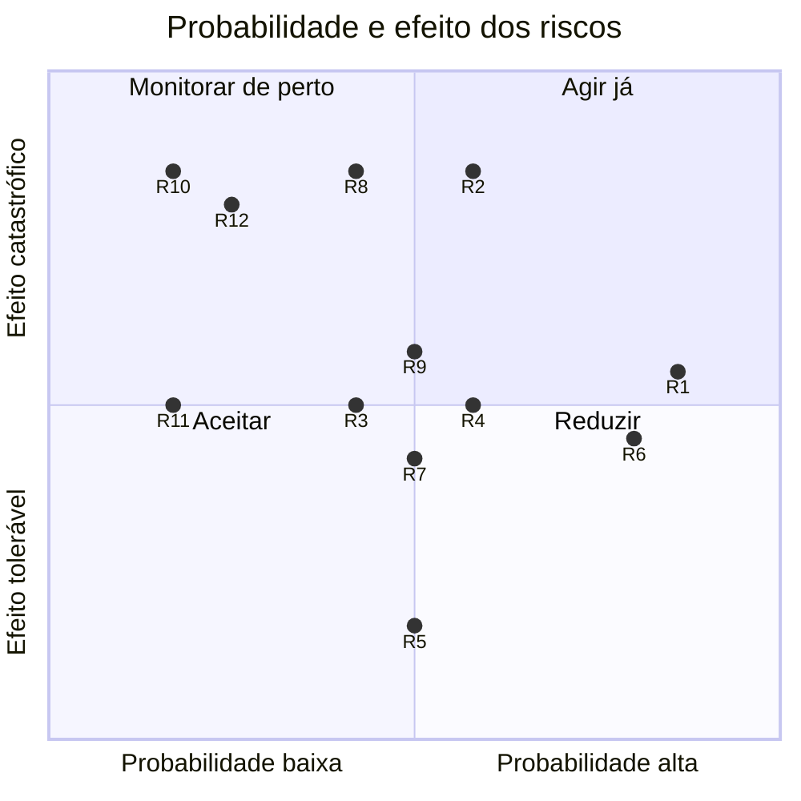

# A07 · Registro de riscos

> Issues #7 e #26 · Referência: SOMMERVILLE, Ian. *Engenharia de software*. 10. ed. São Paulo:
> Pearson, 2018. Seção 22.1, p. 610–616: classes e tipos de risco (Fig. 22.3), probabilidade e
> efeito (Fig. 22.4), estratégias (Fig. 22.5) e indicadores (Fig. 22.6).

**Escala.** Probabilidade: Baixa = 1, Moderada = 2, Alta = 3. Efeito: Tolerável = 1, Grave = 2,
Catastrófico = 3. Exposição = P × E; nível Alto a partir de 6, Médio de 3 a 5, Baixo abaixo de 3
(mesma regra da planilha do Kit). Todos os riscos têm como responsável o autor do projeto; o
professor é informado dos riscos altos de imediato ([A08](A08-comunicacao.md)).

## Registro

| ID | Risco (causa → evento → efeito) | Classe | Tipo | Prob. | Efeito | Exp. | Nível | Estratégia | Ação | Indicador | Plano B |
|---|---|---|---|---|---|---|---|---|---|---|---|
| R1 | Cronograma apertado: 41,5 h estimadas para 40 h disponíveis → atraso no caminho crítico → defesa sem partes essenciais | Projeto | Estimativa | Alta (3) | Grave (2) | 6 | Alto | Minimizar | Fazer o caminho crítico primeiro; reserva de 4 h por corte de escopo ([A05](A05-estimativas.md)) | IDP abaixo de 0,9 em duas semanas; horas restantes acima das horas livres no burndown | Cortar na ordem da tabela de [A05](A05-estimativas.md) |
| R2 | Fotos de bancos públicos diferem das de celular → acurácia baixa em fotos reais → demonstração errada | Produto | Tecnologia | Moderada (2) | Catastrófico (3) | 6 | Alto | Contingência | Fotos reais para teste (#17); revisar o dataset | Acurácia abaixo de 80% no teste real | Acrescentar fotos reais ao treino e subir o limite de recusa; apresentar a limitação |
| R3 | Dataset com orgânico e "não é resíduo" mal rotulado → modelo confunde pessoa ou paisagem com material → resultado absurdo | Produto | Tecnologia | Moderada (2) | Grave (2) | 4 | Médio | Minimizar | Revisar amostra de 50 imagens por classe antes de treinar | Mais de 5% de imagens erradas na amostra; selfie lida como material acima de 70% | Reequilibrar o split e treinar de novo |
| R4 | PyTorch pesado → imagem Docker grande ou memória estourada no plano gratuito → deploy falha | Produto | Tecnologia | Moderada (2) | Grave (2) | 4 | Médio | Contingência | PyTorch só para CPU, versões fixas, imagem enxuta | Build falha no Hugging Face ou imagem acima de 3 GB | Executar no notebook (localhost) na defesa |
| R5 | Overpass e OpenStreetMap sem garantia de disponibilidade → busca real falha → mapa vazio | Produto | Tecnologia | Moderada (2) | Tolerável (1) | 2 | Baixo | Minimizar | Lista salva de mercados de Brasília como reserva automática no #45 | Duas falhas seguidas da busca nos testes | Usar só a lista salva |
| R6 | Vídeo da máquina gerado por IA muda a forma das peças entre quadros → montagem inconsistente → seção principal fraca | Produto | Ferramentas | Alta (3) | Grave (2) | 6 | Alto | Contingência | Gerar poucas tentativas e escolher a melhor; manter o SVG pronto | Peça muda de forma ou posição nos quadros; mais de 2 tentativas sem vídeo aproveitável | Usar a ilustração SVG em camadas (#41) |
| R7 | Limites ou suspensão das contas do Neon e do Hugging Face → banco ou site fora do ar → demonstração indisponível | Projeto | Ferramentas | Moderada (2) | Grave (2) | 4 | Médio | Contingência | Criar contas cedo; guardar o `DATABASE_URL` em secret | Aviso de cota; serviço inacessível por mais de 1 h | SQLite local (sem `DATABASE_URL`) e execução no notebook |
| R8 | Código difícil de explicar na arguição: o autor precisa dominar todo o código → dúvida sem resposta → nota baixa na defesa | Projeto | Pessoas | Moderada (2) | Catastrófico (3) | 6 | Alto | Minimizar | Revisar cada PR e estudar (#33) antes de aprovar | PR aprovado sem o autor conseguir explicá-lo em 1 minuto | Simplificar ou retirar o trecho que não se explica |
| R9 | Pedidos de extras sem registro → escopo cresce → atraso no caminho crítico | Projeto | Requisitos | Moderada (2) | Grave (2) | 4 | Médio | Evitar | Toda mudança passa por [A10](A10-mudancas.md); extras só depois do essencial | Horas em extras antes de #44 e #45 fecharem | Descartar o extra |
| R10 | Câmera exige HTTPS e a rede do local é instável → falha ao vivo → demonstração sem a IA | Projeto | Tecnologia | Baixa (1) | Catastrófico (3) | 3 | Médio | Contingência | Testar a câmera no celular no ensaio (#34) | Câmera falha no ensaio | Vídeo gravado da demonstração e envio de arquivo no notebook |
| R11 | Pressa na escolha de fotos e números → foto sem crédito ou número sem fonte → problema de licença e de credibilidade | Negócio | Organizacional | Baixa (1) | Grave (2) | 2 | Baixo | Evitar | Testes automáticos de crédito e fonte; revisão de cada PR | Foto sem crédito ou número sem link no site | Trocar a foto ou retirar o número |
| R12 | Projeto individual → doença ou imprevisto do autor → atraso sem substituto | Projeto | Pessoas | Baixa (1) | Catastrófico (3) | 3 | Médio | Contingência | Manter tudo no GitHub e na `develop`; documentar o passo a passo | Mais de 2 dias sem trabalho no caminho crítico | Avisar o professor cedo e reduzir o escopo ([A05](A05-estimativas.md)) |

## Matriz de exposição

Eixos: probabilidade (Baixa, Moderada, Alta) e efeito (Tolerável, Grave, Catastrófico). Pontos
com a mesma célula foram afastados um pouco para ficarem legíveis.

## Rotina de revisão semanal (issue #26)

Toda segunda-feira, no início do bloco de trabalho (cerca de 20 minutos):

1. Atualizar o quadro Kanban (WIP máximo de 2 em Fazendo e em Revisão) e fechar as issues entregues.
2. Atualizar o status e o valor agregado ([A09](A09-status-EVM.md)).
3. Medir o indicador de cada risco, reavaliar probabilidade e efeito e conferir os gatilhos.
4. Disparado um gatilho, executar a estratégia ou o plano B e registrar a decisão aqui.
5. Reordenar o que vem em seguida, começando pelo caminho crítico ([A04](A04-cronograma.md)).
6. Passar mudanças de escopo por [A10](A10-mudancas.md); abrir issue para defeito encontrado (#25).

| Semana | Revisão | Riscos reavaliados | Decisões |
|---|---|---|---|
| 1 | 09/11/2026 | | |
| 2 | 16/11/2026 | | |
| 3 | 23/11/2026 | | |
| 4 | 30/11/2026 | | |
