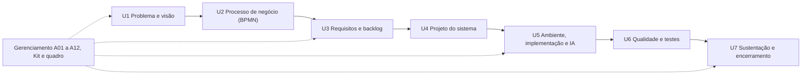

# Jornada do projeto, de U1 a U7 (issue #8, Ficha 1)

> **Nota.** O mapeamento das etapas U1 a U7 abaixo é provisório, baseado no quadro da jornada
> mostrado em aula. Mapeamento a confirmar com o Caderno de Dinâmicas.

Este documento conta o caminho do ReciclaAI do problema até o sistema. Cada etapa diz o que foi
feito e por quê, aponta os artefatos que provam o trabalho, as issues, os pull requests e as
datas, e explica como ela leva à etapa seguinte. As datas vêm do `git log` e das datas de
fechamento das issues e dos PRs no GitHub. Quando não há registro, isso está escrito.

Datas de referência: todo o trabalho termina em **27/11/2026** (marco I3, "Projeto concluído",
[A04](gestao/A04-cronograma.md)); a apresentação final está prevista para **14/12/2026**, ou
antes, conforme o professor marcar.

Situação em 12/11/2026: **3 etapas concluídas** (U1, U2, U4), **3 em andamento** (U3, U5, U6) e
**1 planejada** (U7).

---

## U1 · Problema e visão do produto

**O que foi feito e por quê.** Pouca embalagem volta para a reciclagem no Brasil porque, para
quem joga fora, ela não vale nada; a lata, que tem valor, chega a 97,3% de reciclagem, e na
Alemanha, com depósito devolvido por máquina, mais de 96% das embalagens voltam. A visão do
produto fechou a ideia antes de qualquer código: uma máquina de retorno (RVM) com IA, um site que
vende a máquina e a "lixeira pessoal" (o app) para provar que a IA funciona. Também fixou a regra
central do negócio: o crédito só existe quando a embalagem entra na máquina.

| Artefato | Issue(s) | PR | Data |
|---|---|---|---|
| Código-base do classificador (ResNet18 + Flask) e simulação da RVM (`rvm.py`, `app.py`) | sem issue | #1, #35 | 06/11/2026 (commits `a6cf005`, `23bc3d2`) |
| [Visão do produto](visao-do-produto.md) | sem issue própria | #36 | 07/11/2026 (commit `2a7ea7b`, PR mesclado em 07/11) |
| [A01 · TAP](gestao/A01-TAP.md) (justificativa com fontes e objetivo SMART) e [A02 · Partes interessadas](gestao/A02-partes-interessadas.md) | #4 | #54 | 08/11/2026 |

**Como leva à próxima etapa.** A visão define quem participa (pessoa, máquina, caixa e operador
do local) e as regras do negócio. Para enxergar onde a máquina muda o descarte de hoje, o passo
seguinte é modelar o processo.

**Status:** concluída.

## U2 · Processo de negócio (BPMN)

**O que foi feito e por quê.** Era preciso mostrar, de forma que qualquer um entenda, por que o
descarte atual falha. O BPMN do processo atual (as-is) mostra que a pessoa não ganha nada ao
separar, erra a lixeira e a maior parte termina no aterro. O processo com a ReciclaAI (to-be)
mostra o novo caminho em quatro piscinas: app, máquina, caixa e operador, com os gateways da IA
(confiança de 70%, "não é resíduo", material aceito) e do voucher.

| Artefato | Issue(s) | PR | Data |
|---|---|---|---|
| [Processo de negócio: leitura e comparação](processo/README.md) | #9 | #54 | 08/11/2026 (commit `4f9c647`; issue fechada em 08/11) |
| [processo-atual.bpmn](processo/processo-atual.bpmn) e [imagem](processo/processo-atual.png) | #9 | #54 | 08/11/2026 |
| [processo-com-rvm.bpmn](processo/processo-com-rvm.bpmn) e [imagem](processo/processo-com-rvm.png) | #9 | #54 | 08/11/2026 |

**Como leva à próxima etapa.** Cada tarefa e cada gateway do processo com a máquina vira uma
necessidade concreta ("avisar que não reconheceu", "adicionar à sacola", "gerar voucher"). Essas
necessidades são escritas como histórias de usuário e requisitos na U3.

**Status:** concluída.

## U3 · Requisitos e backlog

**O que foi feito e por quê.** O processo e a visão precisavam virar itens que se possam
construir, priorizar e verificar. Foram escritas 15 histórias de usuário com critérios de
aceitação (Dado/Quando/Então) e prioridade MoSCoW, os requisitos funcionais e não funcionais e a
matriz de rastreabilidade, que liga cada requisito da necessidade até o teste. O backlog é o
conjunto de issues do GitHub, criado por script.

| Artefato | Issue(s) | PR | Data |
|---|---|---|---|
| Quadro, rótulos, marcos e issues ([scripts/github_setup.sh](../scripts/github_setup.sh)) | #2, #3 | #1 | 06/11/2026 (commit `23bc3d2`); issues #2 e #3 fechadas em 07/11 |
| [Histórias de usuário com MoSCoW](requisitos/historias-de-usuario.md) | #10 | #54 | 08/11/2026 (commit `9d6bd3a`) |
| [Requisitos funcionais e não funcionais](requisitos/requisitos.md) | #10 | #54 | 08/11/2026 |
| [Matriz de rastreabilidade (Ficha 3)](requisitos/matriz-de-rastreabilidade.md) | #14 | #56 (aberto) | 08/11/2026 (commit `48c7f06`); issue ainda aberta |

**Como leva à próxima etapa.** As histórias dizem o que o sistema faz; falta decidir como. Os
casos de uso da U4 são derivados das histórias (tabela UC × HU em [uml.md](arquitetura/uml.md)),
e a matriz liga cada requisito ao diagrama que o atende.

**Status:** em andamento. Histórias e requisitos concluídos em 08/11; a matriz está escrita e
aguarda o merge do PR #56. Data planejada para fechar: 13/11/2026 (marco I1).

## U4 · Projeto do sistema

**O que foi feito e por quê.** Antes de construir, era preciso decidir a forma do sistema e
validar a interface com quem usa. A arquitetura define um servidor Flask único, que guarda a IA e
serve o React; o modelo de dados vem das quatro tabelas do `rvm.py`; a UML traz casos de uso,
sequências, classes e estados da sessão. O ADR-001 registra por que o React é servido pelo Flask
(um endereço, um deploy, sem CORS). O protótipo navegável testou o visual e o fluxo do app antes
do código.

| Artefato | Issue(s) | PR | Data |
|---|---|---|---|
| [Protótipo do site e do app](prototipo/README.md) | #13 | #53 | 07/11/2026 (commit `8377aa6`; issue fechada em 07/11) |
| [Arquitetura](arquitetura/arquitetura.md) | #12 | #54 | 08/11/2026 (commit `370e0cf`) |
| [Modelo de dados](arquitetura/modelo-de-dados.md) | #12 | #54 | 08/11/2026 |
| [Diagramas UML](arquitetura/uml.md) | #12 | #54 | 08/11/2026 |
| [ADR-001 · React servido pelo Flask](adr/ADR-001-react-servido-pelo-flask.md) | #38 | #54 | 08/11/2026 |

**Episódio: o mapa do protótipo quebrou.** O mapa do app abria sem fundo: os tiles do servidor
padrão do OpenStreetMap foram bloqueados para esse uso e o CARTO passou a pedir chave. A correção
foi o estilo vetorial do OpenFreeMap, com crédito ao OpenStreetMap
([DEF-03](qualidade/defeitos-encontrados.md)). O protótipo entrou no Git já corrigido, em
07/11/2026; a data do defeito não foi registrada.

**Episódio: mercados reais via Overpass e Photon.** O protótipo busca supermercados reais no
OpenStreetMap. Como o Overpass às vezes falha, a busca virou uma cascata: Overpass (3 km e 6 km),
depois Photon e, por fim, uma lista salva de Brasília ([DEF-04](qualidade/defeitos-encontrados.md),
risco R5 em [A07](gestao/A07-riscos.md)). A decisão de usar a busca real no site virou a mudança
M05 ([A10](gestao/A10-mudancas.md)), que absorveu a antiga issue #49 no #45.

**Como leva à próxima etapa.** Com a arquitetura, as rotas e as tabelas definidas, e com o
protótipo aprovado como referência visual, a construção da U5 segue um plano em partes, cada uma
com issue, arquivos, testes e critério de pronto ([plano de construção](plano-de-construcao.md)).

**Status:** concluída. O ADR-002 (PostgreSQL no Neon) é citado na arquitetura, mas ainda não
existe; será escrito com a issue #52, na U5.

## U5 · Ambiente, implementação e versionamento

**O que foi feito e por quê.** A IA é o coração da máquina, então o projeto precisava de um
ambiente que outra pessoa consiga reproduzir, de um modelo treinado com dados adequados e de um
servidor que use esse modelo com as regras do negócio. Todo o trabalho vai pela branch `develop`,
com PR para a `main` ao fim de cada issue.

| Artefato | Issue(s) | PR | Data |
|---|---|---|---|
| Ambiente com versões fixas ([README](../README.md), `requirements.txt`) | #23 | #51 | 07/11/2026 (commit `8b5d6cb`; issue fechada em 07/11) |
| [Plano de construção](plano-de-construcao.md) em 11 partes | sem issue própria | #37 | 07/11/2026 (commit `35f50c9`) |
| Esqueleto React servido pelo Flask (`frontend/`, `app.py`) | #38 | #54 | 08/11/2026 (commit `361fe51`) |
| Preparação do dataset em 8 classes ([scripts/preparar_dataset.py](../scripts/preparar_dataset.py)) e treino (`treino.py`) | #15, #16 | #54, #55 | 08/11/2026 (commit `a7686bb`; issues fechadas em 08/11) |
| [Resultados do treino](modelo/resultados.md), [métricas](modelo/metricas.json) e [matriz de confusão](modelo/confusion_matrix.png) | #15, #16 | #55 | 08/11/2026 (commit `916bf9b`) |
| Servidor da lixeira pessoal com a IA treinada (`/predict`, `/api/status`) | #20 | #56 (aberto) | 09/11/2026 (commit `b24ece7`) |
| Identidade visual, Lenis e abertura com Vanta (`frontend/src/`) | #39, #40 | #56 (aberto) | 09/11/2026 (commits `c5d8cc4`, `47ac000`, `636bdf4`) |

**Episódio: a selfie lida como plástico.** O modelo de 6 classes respondia "plástico 94%" para
uma foto de rosto: sem uma classe para o que não é resíduo, toda foto vira algum material. A
decisão foi registrada em 07/11 (commit `79f4255`) e virou a mudança M03
([A10](gestao/A10-mudancas.md)): classe `nao_residuo` (pessoas, animais e veículos) e classe
orgânico, num modelo de 8 classes (`a7686bb`, 08/11). No servidor, `nao_residuo` ou confiança
abaixo de 70% vira "não reconhecido", sem material, valor nem lixeira (`b24ece7`, 09/11). Detalhes
em [DEF-02](qualidade/defeitos-encontrados.md).

**Episódio: o dataset dominado por roupas.** Na classe `trash`, a primeira versão da preparação
sorteava as imagens do grupo todo, e roupas e sapatos (cerca de 8.000 candidatas contra cerca de
700 de lixo real) iam dominar a classe. A revisão de código pediu correção antes do commit: cotas
iguais por pasta de origem, com o lixo real entrando inteiro primeiro, e remoção de duplicatas
por hash entre as fontes (`alocar_cotas` e `hash_arquivo` em
[preparar_dataset.py](../scripts/preparar_dataset.py)). Resultado registrado: `trash` com os 697
itens de lixo real mais roupas e sapatos no restante, e 20 imagens duplicadas removidas. A
revisão não tem data registrada; a correção entrou no commit `a7686bb`, em 08/11/2026.

**Resultado: 93,51% no teste.** O treino de 08/11/2026 (ResNet18, 7.510 imagens, 8 classes)
chegou a 93,51% de acurácia no conjunto de teste, acima da meta de 85% da issue #16. A classe
`nao_residuo` acertou as 150 imagens de teste; a principal confusão é vidro lido como plástico
(19 de 150) ([resultados](modelo/resultados.md)).

**Ainda nesta etapa (planejado).** Foto e análise (#43, 16/11), retorno e sacola (#44, 17 a
18/11), mapa com busca real (#45, 19 a 20/11), ilustração e montagem da máquina (#41 e #42, 16 a
18/11), fluxo de branches (#24, 16/11) e banco PostgreSQL no Neon com ADR-002 (#52, 23 a 24/11).

**Como leva à próxima etapa.** Cada parte é entregue com testes, e cada correção feita aqui
(selfie, fotos 404, dataset) precisa de um teste que impeça a volta. A U6 organiza esses testes
num plano, em casos de teste e no registro de defeitos.

**Status:** em andamento. Data planejada para terminar a construção: 20/11/2026 (marco I2); o
banco (#52) fica para 23 a 24/11.

## U6 · Qualidade e testes

**O que foi feito e por quê.** Um sistema que decide se paga ou não uma embalagem precisa provar
que as regras funcionam e que um erro corrigido não volta. Os testes rodam no GitHub Actions a
cada push e PR, e o pipeline falha abaixo de 70% de cobertura do `rvm.py`. O front-end tem testes
próprios em Vitest. Os casos de teste ligam cada teste a requisitos e histórias, e os defeitos
reais ficam registrados com a correção e o teste que os cobre.

| Artefato | Issue(s) | PR | Data |
|---|---|---|---|
| Testes das regras da máquina (`tests/test_rvm.py`, `tests/conftest.py`) | #21 | #51 | 07/11/2026 (commit `dfeb3f2`; issue fechada em 07/11) |
| Pipeline `Testes` (`.github/workflows/testes.yml`) e selo no [README](../README.md) | #22 | #51 | 07/11/2026 (commit `aa36ec7`; issue fechada em 07/11) |
| Testes de rotas e Vitest, com job de front-end no pipeline | #38 | #54 | 08/11/2026 |
| Testes do dataset, do treino e da API (`tests/test_dataset.py`, `tests/test_treino.py`, `tests/test_api.py`) | #15, #16, #20 | #54, #56 (aberto) | 08/11/2026 e 09/11/2026 |
| [Casos de teste](qualidade/casos-de-teste.md) (plano e 47 casos, CT-01 em diante) | #25 (relacionada) | sem PR | sem data registrada (arquivo ainda fora do Git) |
| [Defeitos encontrados](qualidade/defeitos-encontrados.md) (DEF-01 a DEF-05) | #25 | sem PR | sem data registrada (arquivo ainda fora do Git) |

Em 12/11/2026, a `develop` tem 43 testes em Python passando (cobertura de 81% no `app.py` e 82%
no `rvm.py`) e 21 no front-end.

**Ainda nesta etapa (planejado).** Registrar cada defeito como issue com o rótulo `bug` (#25,
17/11) e validar o modelo com fotos reais tiradas para o projeto (#17, 16/11), já que os 93,51%
foram medidos em imagens do Kaggle.

**Como leva à próxima etapa.** Com os testes verdes no pipeline e os defeitos conhecidos
registrados, o sistema pode ser publicado e entregue com segurança, que é o objetivo da U7.

**Status:** em andamento. Data planejada para fechar: 20/11/2026 (marco I2).

## U7 · Sustentação e encerramento

**O que foi feito e por quê.** Um projeto só termina quando outra pessoa consegue usar e retomar
o trabalho. Esta etapa publica o site em HTTPS (o que também libera a câmera no celular), gera o
release, escreve o roteiro de retomada, coleta o aceite e registra as lições aprendidas.

| Artefato | Issue(s) | PR | Data |
|---|---|---|---|
| Site publicado no Hugging Face Spaces | #28 | ainda não existe | planejada para 25/11/2026 |
| Release v1.0 no GitHub | #29 | ainda não existe | planejada para 26/11/2026 |
| Roteiro de retomada e ADRs finais | #30 | ainda não existe | planejada para 26 a 27/11/2026 |
| [A11 · Termo de aceite](gestao/A11-aceite.md) (modelo iniciado em 08/11) | #30 | #54 (modelo) | planejada para 26 a 27/11/2026 |
| [A12 · Lições aprendidas](gestao/A12-licoes.md) (iniciado em 08/11) | #30 | #54 (modelo) | planejada para 26 a 27/11/2026 |
| Indicadores finais (burndown ou valor agregado, [A09](gestao/A09-status-EVM.md)) | #31 | ainda não existe | planejada para 27/11/2026 |
| Slides, estudo para a arguição e ensaio | #32, #33, #34 | ainda não existe | antes da apresentação final (14/12/2026) |

**Como leva ao fim da jornada.** O aceite e o release fecham o produto; o roteiro de retomada e as
lições deixam o caminho registrado para quem continuar. A apresentação final conta essa mesma
jornada, da U1 à U7.

**Status:** planejada. Marco I3, "Projeto concluído": 27/11/2026.

---

## Gerenciamento (atravessa todas as etapas)

O gerenciamento não é uma etapa isolada: ele planeja e acompanha todas as outras. O projeto usa
um modelo híbrido, com marcos planejados (I1, I2, I3), quadro Kanban no GitHub Projects e entregas
por PR ([modelo de desenvolvimento](gestao/modelo-de-desenvolvimento.md)).

| Artefato | Issue(s) | PR | Data |
|---|---|---|---|
| [Plano simplificado A01 a A12](gestao/README.md) | #4, #5, #6, #7 | #54 | 08/11/2026 (commit `1f9d7ae`; issues fechadas em 08/11) |
| [Kit de Artefatos (XLSX)](gestao/Kit_Artefatos_ReciclaAI.xlsx) | #4 a #7 | #54 | 08/11/2026 |
| [Modelo de desenvolvimento](gestao/modelo-de-desenvolvimento.md) | #11 | #54 | 08/11/2026 (commit `ffc32e1`) |
| Quadro Kanban, rótulos e marcos no GitHub ([scripts/github_setup.sh](../scripts/github_setup.sh)) | #3 | #1 | issue fechada em 07/11/2026 |
| [A10 · Mudanças](gestao/A10-mudancas.md) (M01 a M07) | #24 (relacionada) | #54 | 08/11/2026 (commit `ab3052e` para a M07) |
| Esta linha do tempo (Ficha 1) | #8 | ainda não existe | 12/11/2026 |
| Burndown e revisão semanal de quadro e riscos | #26 | ainda não existe | planejada para 20/11/2026 |
| Fichas 2, 7 e 9 do Caderno de Dinâmicas | #27 | ainda não existe | planejada para 18 a 19/11/2026 |

Decisões de gestão que mudaram a jornada: a troca das issues #18, #19 e #50 por #38 a #46 (M06,
issues antigas fechadas em 07/11) e a antecipação do término para 27/11/2026 (M07, aprovada em
08/11/2026), porque os documentos do I1 e o esqueleto React ficaram prontos antes do previsto.

---

## Linha do tempo resumida

| Data | Marco |
|---|---|
| 06/11/2026 | Código-base do classificador e simulação da RVM no repositório (PR #1) |
| 07/11/2026 | Visão do produto (PR #36) e plano de construção (PR #37) |
| 07/11/2026 | Decisão da classe `nao_residuo` após a selfie lida como plástico (`79f4255`) |
| 07/11/2026 | Ambiente reproduzível, testes e pipeline no GitHub Actions (PR #51) |
| 07/11/2026 | Protótipo navegável com mapa no OpenFreeMap e mercados via Overpass e Photon (PR #53) |
| 08/11/2026 | Gestão A01 a A12, BPMN, histórias com MoSCoW, arquitetura, UML, ADR-001 e esqueleto React (PR #54) |
| 08/11/2026 | Mudança M07: término antecipado para 27/11/2026 |
| 08/11/2026 | IA com 8 classes, cotas por origem e sem duplicatas: 93,51% no teste (PR #55) |
| 08/11/2026 | Matriz de rastreabilidade escrita (`48c7f06`, entra com o PR #56) |
| 09/11/2026 | Servidor da lixeira pessoal com a IA treinada, identidade visual e abertura do site (PR #56, aberto) |
| 12/11/2026 | Linha do tempo da jornada (esta ficha, #8) |
| 13/11/2026 | Marco I1 · Jornada e planejamento (planejado) |
| 20/11/2026 | Marco I2 · Construção e qualidade (planejado) |
| 27/11/2026 | Marco I3 · Projeto concluído (planejado) |
| 14/12/2026 | Apresentação final (prevista; pode ser antes, conforme o professor marcar) |

## Rastreabilidade

A ligação de cada requisito com a história, o caso de uso, a issue, o código e o teste está na
[matriz de rastreabilidade](requisitos/matriz-de-rastreabilidade.md) (Ficha 3). Esta linha do
tempo mostra a ordem do caminho; a matriz mostra que cada passo chega ao seguinte.
