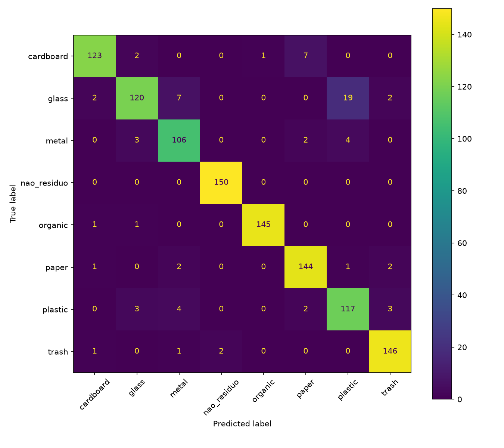

# Resultados do treino do modelo

Treino realizado em 08/11/2026 com `treino.py` (ResNet18 pré-treinada no ImageNet, ajuste fino de `layer4` e `fc`), em uma GPU NVIDIA GeForce RTX 5070.

## Dados

Dataset montado com `scripts/preparar_dataset.py` a partir de dois datasets públicos do Kaggle: Garbage Classification (12 classes), de Mostafa Abla, e Natural Images, de Prasun Roy. As imagens não são redistribuídas no repositório.

| Classe | Imagens | Origem |
|---|---|---|
| cardboard (papelão) | 891 | cardboard |
| glass (vidro) | 1000 | brown-glass, green-glass, white-glass (cotas iguais) |
| metal | 769 | metal |
| organic (orgânico) | 985 | biological |
| paper (papel) | 1000 | paper |
| plastic (plástico) | 865 | plastic |
| trash (rejeito) | 1000 | trash (697, todos) + clothes e shoes (restante) |
| nao_residuo (não é resíduo) | 1000 | airplane, car, cat, dog, motorbike, person (cotas iguais) |
| **Total** | **7510** | 20 imagens duplicadas removidas por hash |

Divisão (`split_dataset.py`, seed 42): 5262 treino, 1124 validação e 1124 teste. O teste só é usado na medição final.

## Resultado

- Melhor época: 3 de 6 (parada antecipada após 3 épocas sem melhora na validação).
- Acurácia na validação: 94,40%.
- **Acurácia no teste: 93,51%** (meta da issue #16: ≥ 85%).

| Classe | Precisão | Recall | F1 |
|---|---|---|---|
| cardboard | 96,1% | 92,5% | 94,3% |
| glass | 93,0% | 80,0% | 86,0% |
| metal | 88,3% | 92,2% | 90,2% |
| nao_residuo | 98,7% | 100,0% | 99,3% |
| organic | 99,3% | 98,6% | 99,0% |
| paper | 92,9% | 96,0% | 94,4% |
| plastic | 83,0% | 90,7% | 86,7% |
| trash | 95,4% | 97,3% | 96,4% |

## Leitura

- A classe **não é resíduo** acertou as 150 imagens de teste: fotos de pessoas, animais e veículos não são confundidas com materiais.
- A principal confusão é **vidro lido como plástico** (19 de 150 garrafas de vidro), seguida de papelão lido como papel (7 de 133). Garrafas transparentes de vidro e de PET são visualmente parecidas; na máquina projetada, a balança e o leitor de código de barras complementam a câmera nessa decisão, e no app a confiança abaixo de 70% pede uma nova foto.
- Próximo passo de validação: fotos reais tiradas para o projeto (issue #17), fora dos datasets do Kaggle.

Arquivos: [`metricas.json`](metricas.json) e [`confusion_matrix.png`](confusion_matrix.png).
