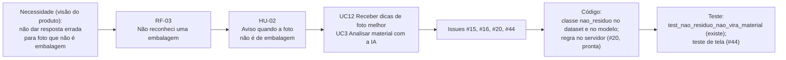

# Matriz de rastreabilidade (issue #14, Ficha 3)

**Versão de 08/11/2026.** Atualizada a cada fechamento de issue; a data acima muda junto.

## Para que serve e como ler

A matriz acompanha cada requisito da [lista de requisitos](requisitos.md) da necessidade até a
verificação: **necessidade (visão) → requisito → história de usuário → caso de uso → issue →
artefato de projeto → código → teste**. Com ela dá para responder, para qualquer linha, "por que
isto existe?" (da direita para a esquerda) e "isto já foi verificado?" (da esquerda para a direita).

- **HU** vem de [historias-de-usuario.md](historias-de-usuario.md); **UC** de
  [uml.md](../arquitetura/uml.md) (seção 1.1); **Issue** do [plano de construção](../plano-de-construcao.md)
  e do [cronograma](../gestao/A04-cronograma.md).
- **Artefato de projeto** é a tarefa do BPMN ([processo-com-rvm.bpmn](../processo/processo-com-rvm.bpmn)),
  o diagrama UML ou a tabela do [modelo de dados](../arquitetura/modelo-de-dados.md).
- **Código** e **Teste** só citam o que existe hoje no repositório; o que falta aparece como
  "a implementar em #N" ou "a escrever em #N".
- **Status:** *Implementado* (código existe), *Em andamento* (parte pronta, issue aberta),
  *Planejado* (nada de código ainda).

## 1. Requisitos funcionais

| RF | Descrição curta | HU | UC | Issue(s) | Artefato de projeto | Código | Teste | Status |
|---|---|---|---|---|---|---|---|---|
| RF-01 | Foto por câmera, arrastar, colar ou arquivo, enviada à IA | HU-01 | UC2 | #20, #43 | BPMN "Fotografar a embalagem no app"; sequência 2 (uml.md) | `POST /predict` e `classify_upload` em `app.py` (#20, pronto); tela em `frontend/src/paginas/LixeiraPessoal.jsx` (esqueleto); captura a implementar em #43 | `test_predict_diz_valor_na_maquina` (`tests/test_api.py`); tela a escrever em #43 (Vitest) | Em andamento |
| RF-02 | Mostra material, lixeira (CONAMA 275), confiança e valor | HU-01 | UC4 | #44 | BPMN "Mostrar o resultado na tela", "Orientar a lixeira certa"; classe `Resultado` | `MATERIALS`, `display` e `/predict` em `app.py` devolvem material, lixeira, cor, confiança e valor (#20); tela a implementar em #44 | `test_predict_diz_valor_na_maquina`, `test_organico_vai_para_lixeira_marrom` (`tests/test_api.py`); tela a escrever em #44 | Em andamento |
| RF-03 | `nao_residuo` ou confiança < 70%: "Não reconheci uma embalagem" com dicas | HU-02 | UC12, UC3 | #15, #16, #20, #44 | BPMN "É resíduo e confiança ≥ 70%?" e "Avisar que não reconheceu"; sequência 2 | classe `nao_residuo` no dataset e no modelo treinado (`scripts/preparar_dataset.py`, `treino.py`; 93,51% de acurácia no teste); regra `nao_reconhecido` no `/predict` de `app.py` (#20); mensagem na tela a implementar em #44 | `test_nao_residuo_nao_vira_material`, `test_confianca_baixa_vira_nao_reconhecido` (`tests/test_api.py`); `test_mapeamento` (`tests/test_dataset.py`); mensagem na tela a escrever em #44 | Em andamento |
| RF-04 | Recusa > 5 MB (413), não imagem (400), modelo ausente (503), com mensagem em JSON | HU-03 | UC2, UC3 | #20, #43 | Sequência 2; classes `BadImage` e `SessionError` (uml.md 4.1) | `BadImage` (400), `handle_too_large` (413) e `ensure_model` (503) em `app.py` | `test_upload_acima_de_5mb_da_413`, `test_arquivo_que_nao_e_imagem_da_400`, `test_sem_arquivo_da_400`, `test_sem_modelo_da_503_com_mensagem` (`tests/test_api.py`) | Implementado |
| RF-05 | Sacola só com itens aceitos, total, remover e desfazer | HU-04 | UC5 | #44 | BPMN "Adicionar à sacola (valor estimado)", "Mais embalagens na sacola?"; classe `Sacola` | a implementar em #44 | a escrever em #44 (Vitest) | Planejado |
| RF-06 | Mapa: mercado mais próximo, distância, tempo a pé, centro de Brasília, aviso e crédito OSM | HU-05 | UC6 | #45 | BPMN "Ir ao mercado mais próximo (mapa)"; classe `Mapa` | a implementar em #45 | a escrever em #45 (Vitest) | Planejado |
| RF-07 | Busca real de mercados no OpenStreetMap, com lista salva se falhar | HU-12 | UC6 | #45 | Classe `Mapa` (uml.md 4.2) | a implementar em #45 | a escrever em #45 | Planejado |
| RF-08 | "Cheguei na máquina" simula o depósito e gera voucher | HU-06 | UC7, UC8 | #47 | BPMN "Ir até a máquina"; sequência 3; tabelas `sessions`, `items`, `vouchers` | a implementar em #47 (reaproveita `/api/session` em `app.py` e `rvm.py`) | a escrever em #47 | Planejado |
| RF-09 | Máquina aceita plástico, metal, vidro com ≥ 70% (R$ 0,10, 0,15, 0,25); devolve o resto com orientação | HU-07 | UC7 | #21, #22, #23 | BPMN "Aceita?", "Devolver a embalagem e informar o motivo"; `items.accepted`, `items.value`, `items.reason` | `rvm.decide`, `rvm.insert_item` e `POST /api/session/<id>/insert` | `test_decide_aceita_plastico_com_confianca`, `test_decide_recusa_abaixo_de_70`, `test_decide_recusa_papel_com_orientacao` (`tests/test_rvm.py`) | Implementado |
| RF-10 | Recusa material com compartimento cheio; balança só representada na simulação | HU-07, HU-09 | UC7 | #21, #22, #23 | BPMN "Balança confere o peso (*)"; tabela `bins` | `rvm.decide` (parâmetro `bin_full`) e `rvm.insert_item` | `test_decide_recusa_compartimento_cheio` (`tests/test_rvm.py`); a balança não mede peso, por decisão do projeto | Implementado |
| RF-11 | Finalizar com saldo emite voucher de uso único; sem saldo, nenhum | HU-07 | UC8 | #21, #22, #23 | BPMN "Saldo > 0?", "Gerar e imprimir o voucher de uso único"; estados de sessão e voucher (uml.md 5); tabela `vouchers` | `rvm.finish_session` e `POST /api/session/<id>/finish` | `test_finish_gera_voucher_so_com_saldo`, `test_sessao_finalizada_recusa_insercao` (`tests/test_rvm.py`) | Implementado |
| RF-12 | Crédito só existe quando a embalagem entra na máquina; o app apenas estima | HU-04, HU-07 | UC5, UC7 | #21, #44 | BPMN "Adicionar à sacola (valor estimado)" x "Compactar, separar e somar o valor"; `sessions.total` | `rvm.insert_item` (soma só itens aceitos); rótulo "estimado" no app a implementar em #44 | `test_insert_soma_saldo` (`tests/test_rvm.py`); texto do app a testar em #44 | Implementado |
| RF-13 | Caixa resgata voucher; usado ou inexistente é recusado | HU-08 | UC9 | #21, #22, #23 | BPMN "Voucher válido e ainda não usado?", "Recusar o voucher"; `vouchers.redeemed_at` | `rvm.redeem_voucher` e `POST /api/vouchers/<code>/redeem` | `test_voucher_so_resgata_uma_vez` (`tests/test_rvm.py`); código inexistente sem teste, a escrever em #52 | Implementado |
| RF-14 | Painel mostra nível dos compartimentos e avisa a partir de 85% | HU-09 | UC10 | #21, #52 | BPMN "Compartimento chegou a 85%?", "Painel avisa ≥ 85%"; tabela `bins` | `rvm.bin_status`, `FULL_WARNING_PCT`, `GET /api/admin/status`, página `/admin` | `test_admin_continua_funcionando` (`tests/test_rotas.py`, só a página); `bin_status` e o aviso de 85% a testar em #52 | Implementado |
| RF-15 | Operador registra o esvaziamento e o nível volta a 0% | HU-10 | UC11 | #21, #52 | BPMN "Esvaziar o compartimento", "Registrar o esvaziamento no painel" | `rvm.empty_bin` e `POST /api/admin/bins/<material>/empty` | a escrever em #52 (`empty_bin`, ao migrar o banco) | Implementado |
| RF-16 | Montagem da máquina em 9 peças ao rolar, com "por que existe" e progresso | HU-13 | UC1 | #41, #42 | Caso de uso UC1; plano, Partes 5 e 6 | a implementar em #41 e #42 (esqueleto em `frontend/src/paginas/PaginaInicial.jsx`) | a escrever em #42 (Vitest) | Planejado |
| RF-17 | Simulador calcula o resultado mensal (pessoas, quem traz, embalagens) | HU-11 | UC13 | #48 | Caso de uso UC13 | a implementar em #48 | a escrever em #48 (Vitest) | Planejado |
| RF-18 | Todo número de impacto traz a fonte | HU-11, HU-13 | UC1, UC13 | #40, #48 | Visão do produto (regra "nenhum número sem fonte") | a implementar em #40 e #48 | a escrever em #40 e #48 | Planejado |

Sobre o treino do modelo (#15 e #16, fechadas): `split_dataset.py`, `treino.py` e
`scripts/preparar_dataset.py` sustentam RF-01 a RF-03 e têm testes em `tests/test_dataset.py`
(`test_split_proporcoes_sem_sobreposicao`, `test_deduplicacao_por_conteudo_entre_fontes` e outros)
e em `tests/test_treino.py` (`test_build_model_sem_pretreino_congela_o_resto`, `test_treino_smoke`).
Os resultados (93,51% de acurácia no teste, meta de 85%) estão em
[resultados.md](../modelo/resultados.md). As rotas do React e da máquina (`/`, `/lixeira`,
`/maquina`, `/admin`) têm `tests/test_rotas.py` (#38).

## 2. Requisitos não funcionais

| RNF | Como é verificado | Issue | Status |
|---|---|---|---|
| RNF-01 Nielsen | Documento `docs/heuristicas-nielsen.md` com prints e arquivos; checklist das 10 heurísticas (#46) | #46 | Planejado |
| RNF-02 Mensagens claras | Testes de API com o texto da mensagem (`test_upload_acima_de_5mb_da_413`, `test_arquivo_que_nao_e_imagem_da_400`, `test_sem_modelo_da_503_com_mensagem`, existem); testes de tela (#43); checklist de Nielsen (#46) | #20, #43, #46 | Em andamento |
| RNF-03 Cor por material | Teste Vitest "todo material tem cor e lixeira" (`frontend/src/dados/materiais.js`, a escrever em #39) | #39 | Planejado |
| RNF-04 `prefers-reduced-motion` | Teste Vitest de `useMenosAnimacao` (#39) e da montagem em SVG (#42); revisão de PR | #39, #42 | Planejado |
| RNF-05 Teclado, alt e contraste | Checklist de Nielsen (#46) e Lighthouse de acessibilidade na página publicada (#28); revisão de PR | #28, #46 | Planejado |
| RNF-06 Desempenho no celular | Lighthouse (#28) e teste manual no celular; revisão de PR | #28, #42, #43 | Planejado |
| RNF-07 Fotos não gravadas | `/predict` lê a imagem na memória e não grava no banco (`test_predict_nao_gera_credito`, existe); revisão de PR; a garantia no navegador entra em #43 e #47 | #20, #43 | Em andamento |
| RNF-08 Upload de 5 MB e voucher de uso único | `test_upload_acima_de_5mb_da_413`, `test_arquivo_que_nao_e_imagem_da_400` e `test_voucher_so_resgata_uma_vez` (existem) | #20, #21 | Implementado |
| RNF-09 Segredos em secrets | Revisão de PR e busca por segredos no código; secrets do GitHub (#52, #28) | #52, #28 | Planejado |
| RNF-10 Ambiente reproduzível | `requirements.txt` com versões fixas e README testado em instalação limpa; o pipeline instala do zero | #23 | Implementado |
| RNF-11 SQLite e PostgreSQL | Testes de `rvm.py` com SQLite temporário (existem, `tests/conftest.py`); teste com `DATABASE_URL` do PostgreSQL a escrever em #52 | #52 | Em andamento |
| RNF-12 Testes no pipeline | `.github/workflows/testes.yml` roda pytest (com `--cov-fail-under=70`) e Vitest a cada push | #22 | Implementado |
| RNF-13 HTTPS e deploy | Deploy no Hugging Face Spaces e teste da câmera no celular (#28) | #28 | Planejado |
| RNF-14 Créditos e licenças | Arquivo de créditos das fotos e revisão de PR (sem marcas) | #40, #41 | Planejado |

## 3. Resumo de cobertura

| Status | RF | RNF |
|---|---|---|
| Implementado | 8 (RF-04, RF-09 a RF-15) | 3 (RNF-08, RNF-10, RNF-12) |
| Em andamento | 3 (RF-01, RF-02, RF-03) | 3 (RNF-02, RNF-07, RNF-11) |
| Planejado | 7 (RF-05 a RF-08, RF-16 a RF-18) | 8 |
| **Total** | **18** | **14** |

"Em andamento" nos RF-01 a RF-03 significa servidor pronto e testado (#20), com a tela ainda por fazer.

**Requisitos sem teste (ou com teste parcial) e a issue que fecha a lacuna:**

- RF-01, RF-02 e RF-03 (lado da tela): #43 e #44, com Vitest.
- RF-05 e RF-12 (texto "estimado"): #44.
- RF-06 e RF-07: #45. RF-08: #47.
- RF-13 (código inexistente), RF-14 e RF-15 (nível, aviso de 85% e esvaziamento): #52, que mexe no banco e deve cobrir `redeem_voucher`, `bin_status` e `empty_bin`.
- RF-16: #42. RF-17: #48. RF-18: #40 e #48.
- RNF de usabilidade e acessibilidade (RNF-01 e RNF-05): #46; Lighthouse em #28.

Os requisitos com teste automático hoje são RF-04 e RF-09 a RF-13 (`tests/test_api.py` e
`tests/test_rvm.py`), mais o lado do servidor de RF-01 a RF-03.

## 4. Exemplo da cadeia completa: "não é resíduo" (RF-03)

## 5. Observação sobre o formato

O layout segue o conceito da Ficha 3 do curso (requisito → história → verificação). Quando o modelo
oficial da ficha estiver disponível, a matriz será alinhada a ele, sem perder as colunas atuais.
