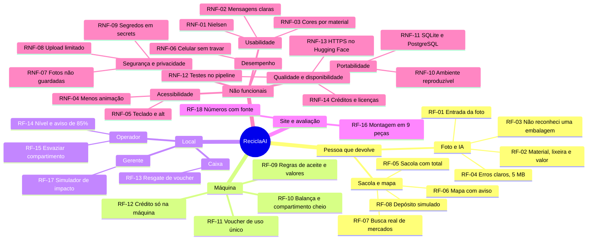

# Requisitos da ReciclaAI (issue #10)

Derivados das [histórias de usuário](historias-de-usuario.md) e da
[visão do produto](../visao-do-produto.md). Cada requisito aponta as histórias que o originam.

## Requisitos funcionais

| ID | Requisito | HU |
|---|---|---|
| RF-01 | O app recebe uma foto por câmera, arrastar, colar (Ctrl+V) ou arquivo e a envia à IA | HU-01 |
| RF-02 | O app mostra material, cor da lixeira (CONAMA 275/2001), confiança e valor na máquina | HU-01 |
| RF-03 | Se a classe for `nao_residuo` ou a confiança for menor que 70%, mostra "Não reconheci uma embalagem nesta foto" com dicas, sem material, valor nem lixeira | HU-02 |
| RF-04 | O servidor recusa arquivo acima de 5 MB (413), arquivo que não é imagem (400) e modelo ausente (503), sempre com mensagem em JSON dizendo como resolver | HU-03 |
| RF-05 | A sacola aceita só itens aceitos pela máquina, soma o total e permite remover e desfazer | HU-04 |
| RF-06 | O mapa mostra o mercado mais próximo, a distância e o tempo a pé; sem localização abre no centro de Brasília; mostra sempre o aviso de demonstração e o crédito ao OpenStreetMap | HU-05 |
| RF-07 | A busca de mercados reais usa o OpenStreetMap e cai na lista salva se falhar | HU-12 |
| RF-08 | O "Cheguei na máquina" simula o depósito da sacola com as mesmas regras da máquina e gera voucher | HU-06 |
| RF-09 | A máquina aceita plástico, metal e vidro com confiança de 70% ou mais, e paga R$ 0,10, R$ 0,15 e R$ 0,25; devolve o resto com orientação | HU-07 |
| RF-10 | A máquina recusa material com compartimento cheio. Na máquina projetada, a balança também devolve garrafa ainda cheia; na simulação do projeto, a balança é representada e não mede peso | HU-07, HU-09 |
| RF-11 | Ao finalizar a sessão com saldo, a máquina emite um voucher de uso único; sem saldo, não há voucher | HU-07 |
| RF-12 | O crédito só existe quando a embalagem entra na máquina; o app apenas estima | HU-04, HU-07 |
| RF-13 | O caixa resgata o voucher no painel; um voucher já usado ou inexistente é recusado | HU-08 |
| RF-14 | O painel mostra o nível de cada compartimento e avisa a partir de 85% | HU-09 |
| RF-15 | O operador registra o esvaziamento e o nível do compartimento volta a 0% | HU-10 |
| RF-16 | O site mostra a montagem da máquina em 9 peças, conduzida pela rolagem, com nome, "por que existe" e barra de progresso | HU-13 |
| RF-17 | O simulador calcula o resultado mensal a partir de pessoas por dia, quantas trazem embalagens e embalagens por pessoa | HU-11 |
| RF-18 | Todo número de impacto exibido traz a fonte citada | HU-11, HU-13 |

## Requisitos não funcionais

| ID | Categoria | Requisito | HU |
|---|---|---|---|
| RNF-01 | Usabilidade (Nielsen) | O site e o app seguem as 10 heurísticas de Nielsen, documentadas com prints em `docs/heuristicas-nielsen.md` | HU-15 |
| RNF-02 | Usabilidade | Mensagens de erro dizem o que houve e como resolver, em português simples | HU-03 |
| RNF-03 | Usabilidade | A mesma cor por material em todas as telas (plástico `#c8453a`, metal `#c99700`, vidro `#2e8b57`, papel `#2f6db5`, orgânico `#8a5a36`, rejeito `#6b6f6a`) | HU-01 |
| RNF-04 | Acessibilidade | Toda animação respeita `prefers-reduced-motion` (Lenis e Vanta desligados; montagem vira SVG com lista das 9 peças) | HU-13 |
| RNF-05 | Acessibilidade | Navegação por teclado, texto alternativo e crédito em toda imagem, contraste legível | HU-13 |
| RNF-06 | Desempenho | A animação não trava no celular; a montagem é mais curta em telas pequenas; a análise mostra "Analisando…" e pode ser cancelada | HU-13 |
| RNF-07 | Segurança e privacidade | Fotos não são gravadas no servidor: ficam só na memória do navegador e a análise não guarda a imagem | HU-01, HU-06 |
| RNF-08 | Segurança | Upload limitado a 5 MB e só imagem; voucher de uso único | HU-03, HU-08 |
| RNF-09 | Segurança | Segredos (por exemplo `DATABASE_URL`) ficam em secrets do GitHub, nunca no código | HU-16 |
| RNF-10 | Portabilidade e reprodutibilidade | `requirements.txt` com versões fixas; Python 3.12; passo a passo no README testado numa instalação limpa | HU-16 |
| RNF-11 | Portabilidade | SQLite localmente e nos testes, PostgreSQL em produção, escolhido por `DATABASE_URL`, com as mesmas funções | HU-16 |
| RNF-12 | Qualidade | Testes automáticos (pytest e Vitest) rodam no GitHub Actions a cada push | HU-07, HU-08 |
| RNF-13 | Disponibilidade | Publicação em HTTPS no Hugging Face Spaces (a câmera exige HTTPS), com deploy automático; plano B em localhost | HU-16 |
| RNF-14 | Legal | Fotos de bancos gratuitos com crédito; sem marca ou logotipo de fabricantes ou de supermercados | HU-13 |

## Mapa de requisitos

Mapa de requisitos em Mermaid (alternativa ao Miro); abre no GitHub e em editores com suporte.

